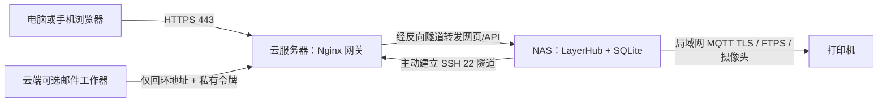

# 部署指导：云服务器 → NAS → 打印机

[English deployment guide](DEPLOYMENT.md) · 版本 0.1.0-beta · 2026-10-27

本文面向**全新独立部署**。示例域名、IP 和公钥都是占位值。不要复制开发者的运行配置，也不要在已有 LayerHub 安装上直接执行首次安装脚本。

## 1. 三部分分别部署什么



| 位置 | 必须部署 | 可选 | 不应承担 |
|---|---|---|---|
| 云服务器 | OpenSSH 受限隧道账号、Nginx、HTTPS 证书 | 邮件工作器、SMTP 配置 | 连接打印机 LAN、存放主业务数据库、再运行一套实时应用 |
| NAS | LayerHub、SQLite/数据目录、systemd 或 Docker、主动隧道 | FFmpeg、SSH 维护入口 | 把打印机端口直接映射到公网 |
| 打印机 | 接入与 NAS 可互通的 LAN；按固件配置局域网权限 | Developer Mode、AMS、摄像头 | 安装 LayerHub 或开放公网访问 |

浏览器关闭或电脑关机后，NAS 上的后台继续工作。NAS 挂起/关机将断开服务；开机自启不能让挂起中的机器保持联网。

### 配置表：部署前填写自己的值

| 项目 | 示例 | 说明 |
|---|---|---|
| 云服务器 SSH 地址 | `cloud.example.com` | 你的公网 IP 或解析到它的域名 |
| 网页域名 | `print.example.com` | A/AAAA 指向云服务器，HTTPS 证书覆盖它 |
| NAS 局域网 IP | `192.168.50.10` | 在路由器做 DHCP 保留 |
| 打印机 IP | `192.168.50.120` | 同样建议固定租约 |
| NAS 应用 | `127.0.0.1:5181` | 不直接监听公网 |
| 云端隧道入口 | `127.0.0.1:15181` | 只有云服务器本机能访问 |

防火墙：云服务器只需对用户开放 TCP 443，证书申请/跳转开放 TCP 80；SSH TCP 22 按维护者和 NAS 出网条件限制来源。**不要开放公网 5181、15181、12222、8883、990 或摄像头端口。** NAS 必须能出站访问云端 SSH、DNS 与校时服务；若所在网络禁止该连接，需先与网络管理者确认允许的出网方案。

NAS 与打印机同 LAN 时无需 Tailscale。电脑的系统代理只影响电脑；网页通过云端访问 NAS，打印机连接由 NAS 自己发起。Tailscale 仅在需要额外路由且网络允许时另配。

## 2. 先在 NAS 启动 LayerHub

建议 Debian 13 / Ubuntu 24.04、amd64。4GB 内存可用于小型打印团队，切片在成员电脑完成；不要同时在多个服务中挂载同一个数据目录。

在 NAS 上安装基本工具：

```sh
sudo apt update
sudo apt install -y openssh-client openssh-server ca-certificates curl python3 ffmpeg
sudo systemctl enable --now ssh
```

从 GitHub Releases 下载 Linux amd64 包和 SHA256SUMS 到 NAS，在解压前校验。只下载 Linux 包时，先从清单筛选这一项：

```sh
grep 'LayerHub-0.1.0-beta-linux-amd64.tar.gz$' SHA256SUMS | sha256sum -c -
tar -xzf LayerHub-0.1.0-beta-linux-amd64.tar.gz
cd LayerHub-0.1.0-beta
sudo sh deploy/nas/install.sh
curl --noproxy '*' http://127.0.0.1:5181/healthz
sudo systemctl status layerhub --no-pager
sudo cat /var/lib/layerhub/data/bootstrap-admin.txt
```

安装器只允许新安装，发现已有用户/服务/数据会停止。初始账号是唯一空间所有者，密码每次全新部署随机生成；重启不重置密码。先在自己的终端读取，登录后修改，不要发到公开问题或截图中。

也支持使用完整本地交付文件夹，或在完整源码仓库执行 `sh tools/build.sh` 后安装。便携包中的 `bin/`、`web/` 布局和源码构建目录都由安装器识别。Windows 包只供本机体验；NAS 使用 Linux 包。

暂时没有云网关时，在电脑上通过你自己的普通 NAS SSH 账号转发：

```sh
ssh -N -L 5182:127.0.0.1:5181 nasadmin@192.168.50.10
```

访问 `http://127.0.0.1:5182/`。此阶段 `LAYERHUB_COOKIE_SECURE=0`；应用保持 offline、启动开关为 0。确认登录、成员和工程页面可用，再继续。

原生安装位置：

| 路径 | 内容 |
|---|---|
| `/opt/layerhub/current` | 当前版本软链接，含 bin 与 web |
| `/etc/layerhub/layerhub.env` | root 可读的服务环境 |
| `/var/lib/layerhub/data` | 数据库、上传文件和加密密钥；归 layerhub 用户 |
| `journalctl -u layerhub` | 服务日志；不应公开整段原始日志 |

## 3. 在 NAS 生成专用隧道密钥

以下只用于新机器；已存在同名用户或文件时先检查，不能覆盖原密钥。

```sh
sudo useradd --system --user-group --create-home \
  --home-dir /var/lib/layerhub-tunnel --shell /usr/sbin/nologin layerhub-tunnel
sudo chmod 700 /var/lib/layerhub-tunnel
sudo -u layerhub-tunnel ssh-keygen -t ed25519 -N '' \
  -f /var/lib/layerhub-tunnel/id_ed25519 -C layerhub-nas-tunnel
sudo cat /var/lib/layerhub-tunnel/id_ed25519.pub
```

**只把 `.pub` 公钥传给云服务器。** 私钥留在 NAS。此无人值守密钥只用于下一步受限的回环端口转发，不使用开发电脑的个人密钥，也不依赖 ssh-agent。

## 4. 云端配置受限 SSH 入口

在云服务器安装 OpenSSH、Nginx 和证书工具。以下适用于 Debian/Ubuntu：

```sh
sudo apt update
sudo apt install -y openssh-server nginx certbot
sudo useradd --system --user-group --create-home \
  --home-dir /var/lib/layerhub-relay --shell /usr/sbin/nologin \
  --password '*' layerhub-relay
sudo install -d -m 700 -o layerhub-relay -g layerhub-relay /var/lib/layerhub-relay/.ssh
```

将 NAS 的公钥保存为云端当前目录的 `nas-tunnel.pub`，检查只有一行有效公钥：

```sh
ssh-keygen -lf nas-tunnel.pub
sed 's/^/restrict,port-forwarding,permitlisten="127.0.0.1:15181" /' nas-tunnel.pub \
  | sudo tee /var/lib/layerhub-relay/.ssh/authorized_keys >/dev/null
sudo chown layerhub-relay:layerhub-relay /var/lib/layerhub-relay/.ssh/authorized_keys
sudo chmod 600 /var/lib/layerhub-relay/.ssh/authorized_keys
sudo install -m 644 deploy/cloud/sshd-layerhub.conf /etc/ssh/sshd_config.d/60-layerhub-relay.conf
sudo sshd -t
sudo sshd -T -C user=layerhub-relay,host=cloud.example.com,addr=192.0.2.10 \
  | grep -E 'allowtcpforwarding|permitlisten|permitopen|maxsessions|gatewayports|passwordauthentication'
```

预期 remote、`127.0.0.1:15181`、none、0、no、no。确认后 `sudo systemctl reload ssh`。**保留当前维护会话，另开一个会话确认正常再退出**；不要改动已有管理员登录策略或套用不清楚的全局 SSH 限制。

此隧道账号无法执行 shell/SFTP，不能替代云服务器维护账号。仅允许 NAS 建立指定反向监听；不会获得 NAS 的 root 权限。

## 5. NAS 固定云端主机指纹并启动隧道

在云服务器控制台/已独立验证的会话查看主机指纹：

```sh
sudo ssh-keygen -lf /etc/ssh/ssh_host_ed25519_key.pub
```

NAS 获取候选公钥，**逐字核对 SHA256 指纹一致后**再信任：

```sh
ssh-keyscan -t ed25519 cloud.example.com > cloud-key.candidate
ssh-keygen -lf cloud-key.candidate
sudo install -d -m 750 -o root -g layerhub-tunnel /etc/layerhub-tunnel
sudo install -m 640 -o root -g layerhub-tunnel cloud-key.candidate /etc/layerhub-tunnel/known_hosts
sudo install -m 640 -o root -g layerhub-tunnel deploy/nas/ssh_config.example /etc/layerhub-tunnel/ssh_config
sudo nano /etc/layerhub-tunnel/ssh_config
```

将 `HostName` 改为自己的云地址；它必须与 known_hosts 中的名称一致。不要用 `StrictHostKeyChecking=no` 或直接接受不明新指纹。

```sh
sudo -u layerhub-tunnel ssh -G -F /etc/layerhub-tunnel/ssh_config layerhub-cloud
sudo install -m 644 deploy/nas/layerhub-tunnel.service /etc/systemd/system/layerhub-tunnel.service
sudo systemctl daemon-reload
sudo systemctl enable --now layerhub-tunnel
sudo journalctl -u layerhub-tunnel -n 30 --no-pager
```

云端验证：

```sh
curl --noproxy '*' http://127.0.0.1:15181/healthz
ss -lnt | grep 15181
```

必须仅监听 `127.0.0.1:15181`。NAS 的后台和隧道是两个服务，都应启用自启。隧道断开会自动重连，但未确认的打印指令不会因重连自动重发。

## 6. 云端配置 HTTPS 网关

先将 `print.example.com` 解析到云服务器。证书签发前只提供 ACME 验证目录，不开放登录：

```sh
sudo install -d -m 755 /var/www/letsencrypt
sudo cp deploy/cloud/nginx-http-bootstrap.conf.example /etc/nginx/conf.d/layerhub.conf
sudo nano /etc/nginx/conf.d/layerhub.conf
sudo nginx -t
sudo systemctl reload nginx
```

替换域名后，在确认 CA 的服务条款并填写自己的证书通知邮箱后签发：

```sh
sudo certbot certonly --webroot -w /var/www/letsencrypt \
  -d print.example.com --email admin@example.com --agree-tos
sudo cp deploy/cloud/nginx.conf.example /etc/nginx/conf.d/layerhub.conf
sudo nano /etc/nginx/conf.d/layerhub.conf
sudo nginx -t
sudo systemctl reload nginx
sudo certbot renew --dry-run
```

域名、证书目录须一致。访问 `https://print.example.com/healthz` 应成功，`https://print.example.com/internal/mail/...` 必须 404。证书无效时先修复证书，不跳过浏览器警告。

NAS 编辑 `/etc/layerhub/layerhub.env`：

```text
LAYERHUB_COOKIE_SECURE=1
LAYERHUB_PUBLIC_URL=https://print.example.com/
```

确保设备仍未接入或已空闲、无活动传输/启动后，`sudo systemctl restart layerhub`，经公网 HTTPS 重新登录。Secure Cookie 开启后，直接访问 NAS 的 HTTP 地址不适合作为登录入口。

## 7. 最后连接打印机：先只读，再逐项控制

1. 打印机和 NAS 必须能互通；固定 DHCP 租约。网络的客户端隔离、VLAN、防火墙都可能阻止互通。
2. 在打印机面板按实际固件开启 LAN Only，获取序列号和 LAN Access Code。需要控制时再核对 Developer Mode；名称和可用性随固件变化。
3. 在空闲维护窗口把 NAS 环境改为 `LAYERHUB_DEVICE_MODE=live`，仍保持 `LAYERHUB_ENABLE_PRINT_START=0`，重启应用。
4. 所有者/管理员在设备管理添加打印机。使用当前型号和模块；输入**自己的** IP、序列号和访问码。
5. 服务端使用系统证书验证或经独立核对的 SHA-256 TLS 指纹，不忽略证书验证。可用只读命令查看候选证书，仍需与可信渠道核对：

```sh
openssl s_client -connect 192.168.50.120:8883 -showcerts </dev/null \
  | openssl x509 -noout -fingerprint -sha256
```

6. 先确认状态、温度、料槽、颜色和摄像头；设备刚上线或旧数据不代表新鲜有效状态。FTPS 不只需要 TCP 990，还需要 NAS 到设备被动数据端口可达。摄像头能力按机型区分。
7. 现场有人时，先测试灯光等低影响设置并核对遥测，再讨论温控、暂停/恢复。**打印开始必须最后验证**：打印板清空、模型/材料/喷嘴/板型/料源相符，现场确认后再开放启动开关。

本版本 X2D 单喷嘴、单色、第一组 AMS 的既有验证不构成所有机型/固件兼容承诺。不要按照图鉴自动添加一批真实设备并发送测试指令。

## 8. 可选：邮件与维护

- **邮件**：阅读 `deploy/mail/README.md`。云端工作器只通过本机 15181 的私有接口领取通知，SMTP 授权码不进网页。当前工作器校验的服务商为 163 / 465 / 隐式 TLS；未声明通用 SMTP 兼容。
- **NAS 维护 SSH**：默认没有从云端到 NAS 的 shell 隧道。如确有需要，单独授权一个普通 NAS 维护账号，另配其密钥；将 `127.0.0.1:12222` 同时加到云端 `PermitListen`、公钥 `permitlisten` 和 NAS `RemoteForward` 后测试。仍只绑定云端回环地址，不开放公网 12222，不默认授权 root。
- **避免挂起掉线**：在 NAS 桌面电源管理关闭自动挂起；无人值守主机可由维护者明确执行 `sudo systemctl mask sleep.target suspend.target hibernate.target hybrid-sleep.target`。恢复时 unmask。此设置不会由安装器擅自修改；重启/断电仍中断服务。

## 9. Docker 作为替代部署方式

已有 Docker Engine + Compose plugin 的 NAS，可在**完整交付文件夹**运行：

```sh
cp deploy/docker/.env.example deploy/docker/.env
docker compose --env-file deploy/docker/.env -f deploy/docker/compose.yaml config
docker compose --env-file deploy/docker/.env -f deploy/docker/compose.yaml up -d --build
docker compose -f deploy/docker/compose.yaml logs --tail=30
docker compose -f deploy/docker/compose.yaml exec layerhub cat /var/lib/layerhub/data/bootstrap-admin.txt
```

不要同时启动原生服务占用 5181。容器只将 5181 发布到 NAS 回环，SSH 隧道仍由 NAS 主机 systemd 管理。Docker 命名卷持久化数据库；**不要执行 `down -v`**，除非确定要删除该测试空间。此基础模板没有自动启用邮件或真实打印。Docker 安装按 [官方 Debian 指南](https://docs.docker.com/engine/install/debian/) 进行；本次未在生产主机安装 Docker，容器实跑状态见测试报告。

## 10. 按顺序验收

NAS 本机健康 → 个人电脑 SSH 预览 → NAS 出站隧道 → 云端回环健康 → 公网 HTTPS 登录 → 成员隔离与备份 → 切片 3MF 校验 → 打印机只读 → 现场基础控制 → 最后实体打印。

每一步保留脱敏结果，不因为前一步成功就跳过后面的条件。具体表格见 [外部验收清单](02-外部验收与反馈.md)。

参考：[OpenSSH PermitListen / MaxSessions](https://man.openbsd.org/sshd_config)、[OpenSSH 公钥选项](https://man.openbsd.org/sshd.8)、[Docker Debian 安装](https://docs.docker.com/engine/install/debian/)、[Bambu Studio 源码与许可](https://github.com/bambulab/BambuStudio)。

Deployment checks / 部署自检：see [Diagnostics / 系统诊断](DIAGNOSTICS.md). Use `--doctor` before startup; directory write probes require `--probe-write`.

已有 Alpha 部署请按 [Beta 迁移说明](BETA_MIGRATION.md) 升级。切片由成员电脑上的 Bambu Studio 完成，NAS 不需要安装切片引擎。
