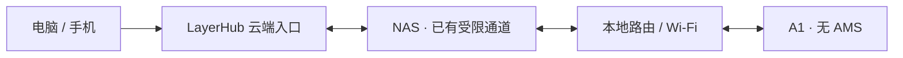

# A1 without AMS / A1 无 AMS 接入准备

Prepared on 2026-10-27 for the on-site session on 2026-10-28. This is a preparation guide; an A1 has not been registered or physically tested yet.

编写日期：2026-10-27；计划现场接入：2026-10-28。这里只准备流程，不代表已连接或验证过这台 A1。

## 中文

### 明天需要准备

| 项目 | 填写位置 / 说明 |
|---|---|
| 型号 | **Bambu Lab A1**，不要选 A1 mini 或 X2D |
| 配置 | **裸机 / 无 AMS**，内部值为 `bare` |
| 连接资料 | 打印机局域网 IP、序列号、LAN Access Code、完整固件版本 |
| 耗材 | 一卷已装入外置料架的实际耗材，登记材质、颜色、净余量；装载到 A1 的 `external` 位置 |
| 切片 | 在 Bambu Studio 选择 A1、实际喷嘴、打印板及该材质，导出已切片 3MF |
| 现场 | 可用 microSD 卡、空打印板、能操作打印机面板的人员 |

访问码在 LayerHub 受限连接配置中填写；不把它写入 GitHub、此文档、截图或公共诊断报告。

### 网络与两个开关

1. 让 A1 接入能与 NAS 通信的 **2.4 GHz Wi-Fi**。NAS 可以继续使用有线连接；两端必须有路由可达，不能被访客网络、客户端隔离或不同 VLAN 的访问规则阻断。A1 官方规格列出 2.4 GHz 频段与 Wi-Fi 连接。[官方快速入门](https://cdn1.bambulab.com/documentation/quick-start-a75adcb1d5d5e/Quick%20Start%20Guide%20for%20A1.pdf)
2. 在打印机面板的设置中找到网络 / WLAN 页面，启用 **LAN Only / 仅局域网**，记录该页面实际显示的 IP 与访问码。菜单名称随固件变化，以面板为准。[官方 LAN 设置入口](https://wiki.bambulab.com/en/knowledge-sharing/enable-lan-mode)
3. 如果固件提供 **Developer Mode / 开发者模式**，在启用 LAN Only 后打开该选项并确认面板提示。拓竹官方说明包括 A1 系列，开发者模式用于保留第三方本地通信通道；LAN 模式本身不等于第三方控制已经获准。[官方说明](https://blog.bambulab.com/updates-and-third-party-integration-with-bambu-connect/) · [官方设置入口](https://wiki.bambulab.com/en/knowledge-sharing/enable-developer-mode)
4. 如果没有这个开关，先记录完整固件版本，核对对应官方固件说明。**不要为了接入先盲目升级或降级**。本次未能读取官方 Wiki 正文，因此这里不写死版本门槛或逐字菜单路径。
5. LAN Only 会改变拓竹云端 / Handy 的可用方式；LayerHub 的远程访问走自己的云端与 NAS 通道。无需、也不能把 Tailscale 安装到 A1 上。

### LayerHub 的对应配置

- 由 NAS 访问打印机；电脑的系统代理不负责发现局域网打印机。
- 型号 `a1`，配置 `bare`。现有驱动包含 A1 的 MQTT、FTPS 与 JPEG 相机分支，真实可用性仍需明天验收。
- 本项目当前驱动默认使用 MQTT TLS 8883、隐式 FTPS 990、JPEG 相机 6000；这是当前实现的连接参数，不宣称为官方稳定 API。只允许 NAS 在局域网访问，打印机端口不用暴露公网。
- 料卷登记在 A1 的**外置料架**；打印准备关闭“使用 AMS”。单盘只允许一份切片耗材。更换材质必须回 Bambu Studio 重新切片，不能只改颜色或库存标签。
- 300°C 喷嘴上限、100°C 热床上限和低帧率相机来自 A1 官方规格；这些是硬件上限，不是材料建议温度。[官方技术参数](https://bambulab.com/pl/a1/tech-specs)
- 页面只开放设备实际上报且已适配的设置，不套用 X2D 的第二喷嘴、腔体或 AMS 单元。相机不承诺 X2D 相同的帧率。

### 首次验收顺序

1. 先查 NAS 到 A1 的 TCP 可达性，再登录 MQTT 读取新鲜遥测；核对序列号、型号、实际状态、温度及外挂料源。
2. 核对外置料架模式和料卷位置，读取相机（如果设备上报支持）。不要因未提供相机信息就自动修改固件。
3. 在现场人员确认后测试一项低影响的可用设置并核对实际反馈；不通过连续重试来绕过授权拒绝。
4. 导入 **A1 专用、单盘、单耗材**小测试文件，保存外置供料准备；检查文件机型、材质、喷嘴与板型。
5. 最后才在确认清板后启动一件小测试。核对开始、结束、机身终止、实际用量结算和重新准备下一项；未经现场确认不自行开打。

能读取但无法控制：重点核对 Developer Mode、访问码是否改变、设备授权 / HMS 提示。完全读不到：先排查路由、Wi-Fi 隔离、IP 和访问码。停止记录已经清板结算、但设备保留 FAILED 时，LayerHub 采用经过任务身份和告警检查的就绪判断，原始遥测不被改写。

## English

Select **A1**, configuration **bare / no AMS**. Prepare the printer's LAN IP, serial, LAN access code and complete firmware version, plus a real external spool and an A1-specific sliced 3MF. Keep the access code out of shared documents and repositories.

Connect A1 to a 2.4 GHz network reachable from the wired NAS. Check routing and client isolation. Enable LAN Only in the printer's network settings, then Developer Mode when the installed firmware exposes it. Record the actual menu and version; do not assume that every firmware has the same switch, or automatically upgrade/downgrade it. The official sources linked above distinguish local third-party access from standard authorization-controlled LAN operation. The Wiki links are supplied for on-site verification; their full text was not accessible during this preparation.

LayerHub reaches A1 from the NAS through its existing cloud/NAS link. No Tailscale installation on the printer is needed. Current driver defaults are MQTT TLS 8883, implicit FTPS 990 and JPEG camera 6000; these describe our implementation, not a promised official API. Do not publish printer ports to the internet.

Register the physical spool on the A1 external mount and leave AMS off in print preparation. Each external-spool plate must use one filament. Slice for the actual A1/nozzle/plate/material in Bambu Studio. Official A1 specifications list a 300°C hotend limit, 100°C bed limit and low-rate camera; these are capabilities, not material presets.

Validate network and fresh identity/status first, external material and optional camera second, an available setting with an on-site person third. Only after explicit plate-clearance confirmation should a small A1-specific single-plate job be printed. Verify start, finish, physical stop, consumption settlement and readiness for another job. Do not send a real print or change firmware merely to complete a software test.

## Sources / 资料

- [A1 official quick-start guide](https://cdn1.bambulab.com/documentation/quick-start-a75adcb1d5d5e/Quick%20Start%20Guide%20for%20A1.pdf)
- [A1 official technical specifications](https://bambulab.com/pl/a1/tech-specs)
- [Official third-party / Developer Mode announcement](https://blog.bambulab.com/updates-and-third-party-integration-with-bambu-connect/)
- [Bambu Lab security white paper](https://cdn1.bambulab.com/trust-center/file/bambulab-security-whitepaper-en.pdf)
- Official Wiki LAN / Developer Mode links above; model and firmware details remain to be confirmed on the actual A1.
