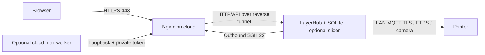

# Deployment: cloud gateway → NAS → printer

[简体中文](01-部署指导-云服务器-NAS-打印机.md) · 0.3.0-alpha · 2026-10-27

This guide targets a **new, independent installation**. Replace every example host, address and key. Do not run the first-install script against an existing LayerHub workspace.

## Responsibilities and network layout



| Host | Required components | Optional components |
|---|---|---|
| Cloud | OpenSSH restricted relay account, Nginx, TLS certificate | Mail worker and SMTP credentials |
| NAS | LayerHub application and SQLite, persistent private data, systemd or Docker, outbound SSH tunnel | Independently installed slicer, FFmpeg, separately authorized SSH maintenance |
| Printer | Reachable LAN connection and firmware-specific LAN permissions | Developer Mode, AMS and camera as supported |

The NAS owns the only live workspace. Do not run another cloud application against a copied/shared live database. Closing the browser does not stop background work; suspending the NAS does. Autostart cannot keep a suspended computer online.

Example values:

- Cloud SSH host: `cloud.example.com`; web domain: `print.example.com`.
- NAS: `192.168.50.10`; printer: `192.168.50.120`; reserve their DHCP leases.
- NAS application: `127.0.0.1:5181`; cloud reverse listener: `127.0.0.1:15181`.

Allow public TCP 443, TCP 80 for ACME/redirects, and appropriately restricted SSH 22. **Do not expose 5181, 15181, 12222, 8883, 990 or camera ports to the Internet.** The NAS needs allowed outbound SSH, DNS and time synchronization. If the site blocks that traffic, arrange an approved network path first. No Tailscale is required when NAS and printer can already reach each other on the LAN. A laptop's proxy does not route NAS-to-printer traffic.

## 1. Install the application on the NAS

Reference systems: Debian 13 / Ubuntu 24.04, amd64. The supplied binaries are amd64 only. A 4GB machine is suitable for small tests with one slicing task at a time.

```sh
sudo apt update
sudo apt install -y openssh-client openssh-server ca-certificates curl python3 ffmpeg
sudo systemctl enable --now ssh
grep 'LayerHub-0.3.0-alpha-linux-amd64.tar.gz$' SHA256SUMS | sha256sum -c -
tar -xzf LayerHub-0.3.0-alpha-linux-amd64.tar.gz
cd LayerHub-0.3.0-alpha
sudo sh deploy/nas/install.sh
curl --noproxy '*' http://127.0.0.1:5181/healthz
sudo systemctl status layerhub --no-pager
sudo cat /var/lib/layerhub/data/bootstrap-admin.txt
```

Download the Linux amd64 archive and SHA256SUMS from GitHub Releases to the NAS before running these commands. The installer also accepts the full local distribution folder, or a complete clone after `sh tools/build.sh`; it recognizes both the portable `bin/` + `web/` layout and the source build layout. Use the Linux package on the NAS, not the Windows package.

The installer refuses existing users, services or application data. First startup creates a random password for the sole workspace owner. Restarting does not reset it. Read it in your own terminal, sign in and change it; do not post it in screenshots or issues.

For initial browser access from your computer:

```sh
ssh -N -L 5182:127.0.0.1:5181 nasadmin@192.168.50.10
```

Open `http://127.0.0.1:5182/`. Keep `LAYERHUB_COOKIE_SECURE=0`, device mode offline and print-start disabled for this local HTTP test.

- `/opt/layerhub/current`: installed binary and web assets.
- `/etc/layerhub/layerhub.env`: root-readable environment settings; the binary does not auto-load .env.
- `/var/lib/layerhub/data`: database, uploads, model data and master.key, owned by the service account.
- `journalctl -u layerhub`: service logs. Share only redacted excerpts.

## 2. Generate a dedicated NAS tunnel key

Use this only on a fresh system. Review existing users/files instead of overwriting keys.

```sh
sudo useradd --system --user-group --create-home \
  --home-dir /var/lib/layerhub-tunnel --shell /usr/sbin/nologin layerhub-tunnel
sudo chmod 700 /var/lib/layerhub-tunnel
sudo -u layerhub-tunnel ssh-keygen -t ed25519 -N '' \
  -f /var/lib/layerhub-tunnel/id_ed25519 -C layerhub-nas-tunnel
sudo cat /var/lib/layerhub-tunnel/id_ed25519.pub
```

Transfer only the `.pub` key to your cloud administrator. The private key remains on the NAS. This unattended key is limited to a specific loopback reverse forward and does not use your personal ssh-agent.

## 3. Configure the cloud relay account

```sh
sudo apt update
sudo apt install -y openssh-server nginx certbot
sudo useradd --system --user-group --create-home \
  --home-dir /var/lib/layerhub-relay --shell /usr/sbin/nologin \
  --password '*' layerhub-relay
sudo install -d -m 700 -o layerhub-relay -g layerhub-relay /var/lib/layerhub-relay/.ssh
```

Save the NAS public key as `nas-tunnel.pub`, then:

```sh
ssh-keygen -lf nas-tunnel.pub
sed 's/^/restrict,port-forwarding,permitlisten="127.0.0.1:15181" /' nas-tunnel.pub \
  | sudo tee /var/lib/layerhub-relay/.ssh/authorized_keys >/dev/null
sudo chown layerhub-relay:layerhub-relay /var/lib/layerhub-relay/.ssh/authorized_keys
sudo chmod 600 /var/lib/layerhub-relay/.ssh/authorized_keys
sudo install -m 644 deploy/cloud/sshd-layerhub.conf /etc/ssh/sshd_config.d/60-layerhub-relay.conf
sudo sshd -t
sudo sshd -T -C user=layerhub-relay,host=cloud.example.com,addr=192.0.2.10 \
  | grep -E 'allowtcpforwarding|permitlisten|permitopen|maxsessions|gatewayports|passwordauthentication'
```

Expected restrictions: remote forwarding only, listener `127.0.0.1:15181`, no local-forward destinations, zero shell sessions, no public gateway binding and no password login. After checking, run `sudo systemctl reload ssh`. Keep the existing administrator session open and test a second session before disconnecting. Do not change unrelated administrator login policies.

The relay user cannot run shell commands or SFTP. It is not the cloud maintenance account and does not grant NAS root access.

## 4. Pin the cloud SSH host key on the NAS

On the cloud console or an independently trusted session:

```sh
sudo ssh-keygen -lf /etc/ssh/ssh_host_ed25519_key.pub
```

On the NAS, collect a candidate and **independently compare its SHA256 fingerprint** before trusting it:

```sh
ssh-keyscan -t ed25519 cloud.example.com > cloud-key.candidate
ssh-keygen -lf cloud-key.candidate
sudo install -d -m 750 -o root -g layerhub-tunnel /etc/layerhub-tunnel
sudo install -m 640 -o root -g layerhub-tunnel cloud-key.candidate /etc/layerhub-tunnel/known_hosts
sudo install -m 640 -o root -g layerhub-tunnel deploy/nas/ssh_config.example /etc/layerhub-tunnel/ssh_config
sudo nano /etc/layerhub-tunnel/ssh_config
```

Replace HostName with your cloud host; it must match known_hosts. Do not disable host-key checking to resolve a mismatch.

```sh
sudo -u layerhub-tunnel ssh -G -F /etc/layerhub-tunnel/ssh_config layerhub-cloud
sudo install -m 644 deploy/nas/layerhub-tunnel.service /etc/systemd/system/layerhub-tunnel.service
sudo systemctl daemon-reload
sudo systemctl enable --now layerhub-tunnel
sudo journalctl -u layerhub-tunnel -n 30 --no-pager
```

On the cloud, verify:

```sh
curl --noproxy '*' http://127.0.0.1:15181/healthz
ss -lnt | grep 15181
```

The listener must be loopback-only. Both application and tunnel services need autostart. Reconnection does not automatically retry an unconfirmed print command.

## 5. Enable the cloud HTTPS gateway

Point your web domain to the cloud host. Before certificate issuance, serve only the ACME challenge path:

```sh
sudo install -d -m 755 /var/www/letsencrypt
sudo cp deploy/cloud/nginx-http-bootstrap.conf.example /etc/nginx/conf.d/layerhub.conf
sudo nano /etc/nginx/conf.d/layerhub.conf
sudo nginx -t
sudo systemctl reload nginx
```

Replace the domain. Review the CA's service terms and use your own certificate-notification email before issuing a certificate:

```sh
sudo certbot certonly --webroot -w /var/www/letsencrypt \
  -d print.example.com --email admin@example.com --agree-tos
sudo cp deploy/cloud/nginx.conf.example /etc/nginx/conf.d/layerhub.conf
sudo nano /etc/nginx/conf.d/layerhub.conf
sudo nginx -t
sudo systemctl reload nginx
sudo certbot renew --dry-run
```

Use matching domain and certificate paths. `https://print.example.com/healthz` must work; public `/internal/mail/...` must return 404. Fix certificate errors instead of bypassing browser warnings.

On the NAS set:

```text
LAYERHUB_COOKIE_SECURE=1
LAYERHUB_PUBLIC_URL=https://print.example.com/
```

Once devices are disconnected or freshly idle, with no active slices/transfers, restart `layerhub`. Sign in again through public HTTPS. With Secure cookies enabled, plain NAS HTTP is not a suitable login endpoint.

## 6. Connect the printer last

1. Ensure NAS-to-printer LAN reachability. Client isolation, VLANs and firewalls may block it.
2. Follow the actual printer firmware to enable LAN Only and retrieve serial/access code. Check Developer Mode separately for control; labels and permissions may vary.
3. In an idle maintenance window set `LAYERHUB_DEVICE_MODE=live`, keep `LAYERHUB_ENABLE_PRINT_START=0`, then restart the app.
4. Add your own printer IP, serial, model/modules and access code in Device Management.
5. The service validates system certificates or an independently verified SHA256 certificate pin. A candidate fingerprint can be inspected with the following command, but this alone does not authenticate it:

```sh
openssl s_client -connect 192.168.50.120:8883 -showcerts </dev/null \
  | openssl x509 -noout -fingerprint -sha256
```

6. Confirm fresh telemetry, temperatures, slots, colors and camera first. FTPS requires passive data connectivity in addition to TCP 990. Camera support is model-specific.
7. With someone physically present, verify low-impact controls and returned telemetry before temperature or pause/resume tests. **Test print start last**, only after checking the empty plate, model, material, nozzle, bed and filament mapping.

Existing X2D single-nozzle/single-color/first-AMS validation is not a compatibility claim for every catalog illustration or firmware.

## Optional components

- **Slicing**: see `deploy/slicer/README.md`. Install the pinned engine independently. The core Docker image does not contain Studio's graphical runtime dependencies; native NAS deployment is the reference for complete slicing. Without it, upload files sliced in your desktop slicer.
- **Email**: see `deploy/mail/README.md`. The cloud worker uses loopback port 15181 plus a private relay token. SMTP secrets stay off the web frontend. This alpha worker validates 163 SMTP/465/implicit TLS; it is not a general SMTP-provider compatibility claim.
- **NAS SSH maintenance**: not enabled by default. If needed, explicitly authorize a separate regular NAS administrator and key. Add `127.0.0.1:12222` consistently to cloud PermitListen, the authorized-key permitlisten options and NAS RemoteForward. Keep it loopback-only; do not enable public port 12222 or assume root access.
- **Suspension**: disable automatic suspend in the NAS desktop power settings. An administrator may explicitly mask sleep/suspend/hibernate targets with systemctl if desired; the installer does not change power policy automatically. Power loss/restarts still interrupt services.

## Docker alternative

After installing Docker Engine and the Compose plugin through the [official Debian instructions](https://docs.docker.com/engine/install/debian/), run from the complete distribution folder:

```sh
cp deploy/docker/.env.example deploy/docker/.env
docker compose --env-file deploy/docker/.env -f deploy/docker/compose.yaml config
docker compose --env-file deploy/docker/.env -f deploy/docker/compose.yaml up -d --build
docker compose -f deploy/docker/compose.yaml logs --tail=30
docker compose -f deploy/docker/compose.yaml exec layerhub cat /var/lib/layerhub/data/bootstrap-admin.txt
```

Do not start the native service on the same port. Docker publishes the app only on NAS loopback; the SSH tunnel stays on the host. The named volume persists data. Do not use `down -v` unless intentionally deleting a disposable workspace. This basic template includes neither slicer nor preconfigured email/real printing. Check the validation report for the distinction between static checks and an actual Docker run.

Acceptance order: NAS health → private SSH browser preview → outbound tunnel → cloud loopback health → public HTTPS login → member isolation/backup → shared-project copying → slicing → printer read-only telemetry → attended basic controls → attended print.

References: [OpenSSH server configuration](https://man.openbsd.org/sshd_config), [authorized-key options](https://man.openbsd.org/sshd.8), [Docker installation](https://docs.docker.com/engine/install/debian/), [Bambu Studio](https://github.com/bambulab/BambuStudio).

Deployment checks / 部署自检：see [Diagnostics / 系统诊断](DIAGNOSTICS.md). Use `--doctor` before startup; directory write probes require `--probe-write`.
