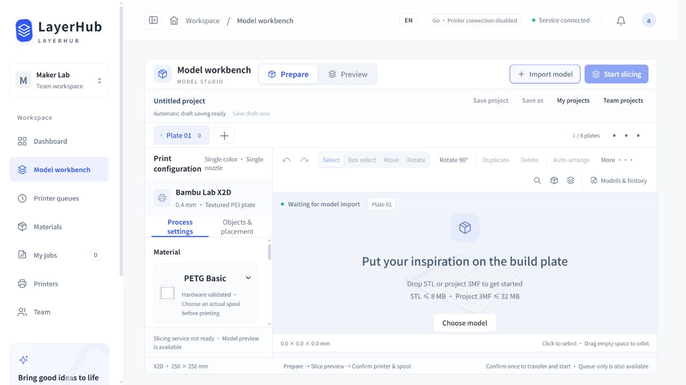

# LayerHub

[简体中文](README.zh-CN.md) | [English deployment](DEPLOYMENT.md) | [中文部署指导](01-部署指导-云服务器-NAS-打印机.md)

A self-hosted workspace for shared 3D printers: per-printer queues, spool inventory, private slicing projects, team snapshots and task notifications.

**0.2.0-alpha: independent deployment testing.** The NAS owns the application/database and talks to LAN printers; a cloud host provides HTTPS through a restricted outbound SSH tunnel.

## Start here

- Download a portable Windows/Linux amd64 package from Releases to test a fresh offline workspace. No printer access or print-start permission is enabled by default.
- Extract the package, then run `start.cmd` on Windows or `sh start.sh` on Linux. Open `http://127.0.0.1:5181/`; first-run credentials are in the newly generated `data/bootstrap-admin.txt`. Keep the terminal open; Ctrl+C stops the application. The portable launcher does not install an autostart service.
- Follow [Deployment](DEPLOYMENT.md) for exactly what belongs on the cloud, NAS and printer.
- Follow [Acceptance tests](TESTING.md), [Operations](OPERATIONS.md) and [Security](SECURITY.md).
- Full slicing uses an independently installed engine: [slicer setup](deploy/slicer/README.md). Engine binaries/networking plugins are not bundled.

## Repository layout

| Directory | Purpose |
|---|---|
| `source/` | Go/JavaScript source, vendored Go dependencies and tests |
| `deploy/cloud/` | HTTPS gateway, ACME bootstrap and restricted SSH configuration |
| `deploy/nas/` | Fresh systemd installer, environment and outbound tunnel templates |
| `deploy/docker/` | Loopback-published base application container template |
| `deploy/slicer/` | Optional pinned-engine preparation; no engine binaries |
| `deploy/mail/` | Optional cloud 163 SMTP worker configuration |
| `tools/` | Build, source-offer generation, packaging and smoke checks |
| `licenses/` | Third-party license copies |
| `validation/` | Redacted release validation records |

## Build from a clone

Requires Go 1.27+ and Python 3. Go dependencies are vendored.

```sh
sh tools/build.sh
python3 tools/package.py
```

On Windows, run `powershell -NoProfile -ExecutionPolicy Bypass -File tools/build.ps1`, then `python tools/package.py`. This process-local execution-policy flag does not change the machine policy. Node.js 24 and the pinned jsdom test dependencies are needed only for frontend tests; see source/README.md.

After building, the Docker template can use the generated Linux binary and local corresponding-source archive. The basic Docker image does not contain Studio's graphical runtime. Native Linux is the complete reference deployment. See the [validation record](validation/README.md) for tests actually executed versus static checks. The application supports Simplified Chinese and English, including sign-in, printer controls and slicing. Choose Language in Personal account or on the sign-in form. [Language behavior](LANGUAGES.md).

## Current validation scope



Hardware validation is concentrated on one X2D/0.4 mm/single-color PETG Basic configuration and its tested firmware/modules. Catalog artwork is not a compatibility claim. Other firmware, models and network conditions need independent validation. Multi-nozzle/multicolor start, motion/filament controls, mesh cutting and a desktop installer are outside this alpha's claims.

## License and source offer

Original project code/artwork: **AGPL-3.0-only**. Third-party components retain their own notices: [LICENSE](LICENSE), [THIRD_PARTY_NOTICES](THIRD_PARTY_NOTICES.md). The deployed UI includes a source/license link and a matching source archive, including vendored Go sources. Regenerate that archive after modifying a hosted release.

This repository and release packages must never contain production databases, credentials, private printer files or mail/SSH tokens. Every installation generates its own owner password and data encryption key.
