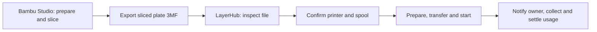
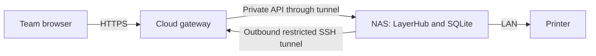

# LayerHub

### Team printer management, from sliced file to finished print.

**English** · [简体中文](README.zh-CN.md)

[](https://github.com/Tuang-Gaashuan/LayerHub/actions/workflows/ci.yaml)
[](https://github.com/Tuang-Gaashuan/LayerHub/releases/tag/v0.1.1-beta)
[](https://github.com/Tuang-Gaashuan/LayerHub/releases/tag/v0.4.0-alpha)
[](LICENSE)

[Download Beta](https://github.com/Tuang-Gaashuan/LayerHub/releases/tag/v0.1.1-beta) · [Download Alpha](https://github.com/Tuang-Gaashuan/LayerHub/releases/tag/v0.4.0-alpha) · [Compare channels](CHANNELS.md) · [Deployment](DEPLOYMENT.md) · [Importing](IMPORTING.md) · [Validation](validation/README.md)

LayerHub is a self-hosted workspace for teams sharing 3D printers. Prepare and slice in **Bambu Studio**, then use LayerHub to assign a printer, confirm real spools, coordinate its queue, monitor progress and receive notifications.

**Recommended setup: LayerHub Beta + [Bambu Studio](https://github.com/bambulab/BambuStudio).** Prepare and slice on your computer, then upload the sliced 3MF for team scheduling, printer control and notifications.

## New in v0.1.1-beta

Batch plate selection, printer-side stop handling, faster controls, A1 external-spool preparation and a standalone download/update kit ship together. See [release notes](RELEASE_NOTES.md), [Update Kit](deploy/update-kit/README.md), [A1 setup](A1_SETUP.md) and [multi-plate imports](MULTIPLATE.md).

**Back up before upgrading:** schema 5 requires coordinated NAS/backend and cloud/UI updates while idle. Older readers need the matching pre-upgrade workspace for rollback. A1 hardware and real multi-plate printing still need attended acceptance.

## Beta and Alpha

| Channel | Focus | Maintenance | Version tag | Download |
|---|---|---|---|---|
| **Beta · recommended** | Team printer management; upload already-sliced 3MF | Primary development on [`main`](https://github.com/Tuang-Gaashuan/LayerHub/tree/main) | [`v0.1.1-beta`](https://github.com/Tuang-Gaashuan/LayerHub/tree/v0.1.1-beta) | [Beta release](https://github.com/Tuang-Gaashuan/LayerHub/releases/tag/v0.1.1-beta) |
| **Alpha · experimental workbench** | Team printing with an integrated model workbench and online slicing | Gradual workbench development on [`alpha`](https://github.com/Tuang-Gaashuan/LayerHub/tree/alpha) | [`v0.4.0-alpha`](https://github.com/Tuang-Gaashuan/LayerHub/tree/v0.4.0-alpha) | [Alpha release](https://github.com/Tuang-Gaashuan/LayerHub/releases/tag/v0.4.0-alpha) |

Beta is the mainline for ongoing feature refinement. Its model workbench, geometry import, online slicing, 3D editing and shared model projects have been removed from the UI, APIs and runtime. Alpha retains those experimental features and will progress more slowly on its own branch. Both channels currently have prerelease status; their version numbers advance independently. Read the [full comparison and maintenance policy](CHANNELS.md) or the [Alpha → Beta migration guide](BETA_MIGRATION.md).

## What Beta includes

| Area | Capabilities |
|---|---|
| Team dashboard | Printer availability, active work, per-machine queues and tasks awaiting attention |
| Sliced 3MF intake | Inspect actual contents, preview plate/material colors and estimates, retain the original sliced process |
| Per-printer scheduling | Confirm the destination and spool, reserve material, then prepare/transfer/start once; queue-only remains available |
| Spool inventory | Individual rolls, shared/private ownership, colors, remaining weight and printer/AMS slot registration |
| Printer console | Telemetry, supply status, supported controls, camera/video and snapshots according to device permissions |
| Notifications | Optional verified member email; start, device-finished and other milestones notify the job owner |
| Team and security | Workspace owner, administrator and member roles; session management, audit history and owner-only backups |
| Reading preferences | English / Simplified Chinese, fonts and text appearance |
| Deployment diagnostics | Local `--doctor`, separate browser/gateway/NAS/printer evidence and redacted reports |

## The workflow


This offline demo shows sliced plates and material colors in a compact file review. [English dashboard](validation/beta-dashboard-en.png).



Only **already-sliced `.3mf` files**, including `.gcode.3mf`, are accepted. Detection uses archive contents; renaming an STL, raw G-code or unsliced project does not make it printable. Inspection creates no job, material reservation or printer command. Single-plate estimates prefill the queue form; missing and multi-plate values stay blank for deliberate confirmation. [File guidance](IMPORTING.md).

Printing does not start from file inspection. Device, queue, model, nozzle, build plate, material/feed mapping and authorization checks remain. Reconnection never silently repeats an uncertain start. Device completion can email the owner immediately, while physical collection and actual material settlement remain separate actions.

## Cloud → NAS → printer



The NAS owns the live application and database and connects to the printer locally. The cloud provides HTTPS and the restricted relay, plus an optional mail worker. Bambu Studio runs on members' computers; no slicing engine is required on the NAS. Suspending the NAS interrupts its services even with autostart enabled.

## Try it locally

Download a platform archive and `SHA256SUMS` from [v0.1.1-beta](https://github.com/Tuang-Gaashuan/LayerHub/releases/tag/v0.1.1-beta), verify the checksum and extract to a new directory.

Windows PowerShell:

```powershell
Get-FileHash .\LayerHub-0.1.1-beta-windows-amd64.zip -Algorithm SHA256
Expand-Archive .\LayerHub-0.1.1-beta-windows-amd64.zip -DestinationPath .
Set-Location .\LayerHub-0.1.1-beta
.\start.cmd
```

Linux:

```sh
grep 'LayerHub-0.1.1-beta-linux-amd64.tar.gz$' SHA256SUMS | sha256sum -c -
tar -xzf LayerHub-0.1.1-beta-linux-amd64.tar.gz
cd LayerHub-0.1.1-beta
sh start.sh
```

Open `http://127.0.0.1:5181/`. Fresh installations default to offline mode with print start disabled. Read the generated owner credentials from `data/bootstrap-admin.txt`; keep them private. Closing the launcher stops this local test service. For an existing installation, follow [migration](BETA_MIGRATION.md), not the fresh-only installer.

## Scope and deployment

Windows amd64 and Linux amd64 packages are supplied. Native Linux is the reference NAS deployment; Docker templates are provided but Docker runtime remains independently unverified. Optional camera/video and SMTP delivery require their respective components and permissions.

Hardware print evidence remains concentrated on the previously attended **X2D / 0.4 mm / single-color PETG Basic / first AMS** setup. Catalog illustrations do not establish control compatibility. Multicolor or dual-nozzle starts are not newly supported by Beta.

| Guide | Purpose |
|---|---|
| [Deployment](DEPLOYMENT.md) / [中文部署](01-部署指导-云服务器-NAS-打印机.md) | Cloud, NAS and printer responsibilities and installation |
| [Importing](IMPORTING.md) | Sliced 3MF requirements and queue preparation |
| [Alpha → Beta](BETA_MIGRATION.md) | Retired features, preserved data and rollback |
| [Operations](OPERATIONS.md) / [中文运维](03-升级备份与排障.md) | Backups, maintenance and troubleshooting |
| [Diagnostics](DIAGNOSTICS.md) | Local checks and connection evidence |
| [Acceptance](TESTING.md) / [中文验收](02-外部验收与反馈.md) | Independent deployment and hardware validation |
| [Language](LANGUAGES.md) | Account language and notification behavior |

## Build and license

Go 1.27, Node.js 24 and Python 3 are the build/test tools. Go dependencies are vendored. Run `sh tools/build.sh` or `tools/build.ps1`; see [source guidance](source/README.md). Runtime does not depend on Node, Python, Three.js or a slicing engine.

Original project code and schematic artwork are **AGPL-3.0-only**. Third-party dependencies retain their licenses; see [notices](THIRD_PARTY_NOTICES.md). Hosted deployments provide matching source through the footer. Public source/packages exclude accounts, databases, credentials, private uploads and backups. Report issues with redacted reproduction steps rather than a whole data directory.


[A1 without AMS setup](A1_SETUP.md) · [Multi-plate import guide](MULTIPLATE.md)
