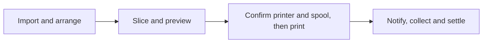
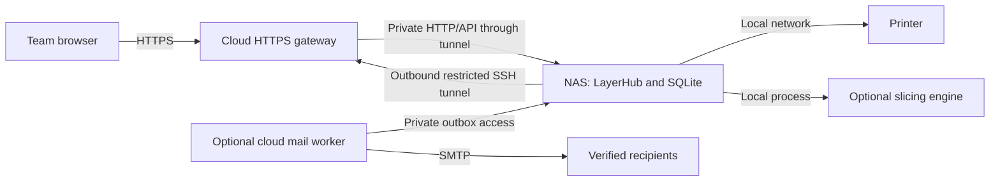
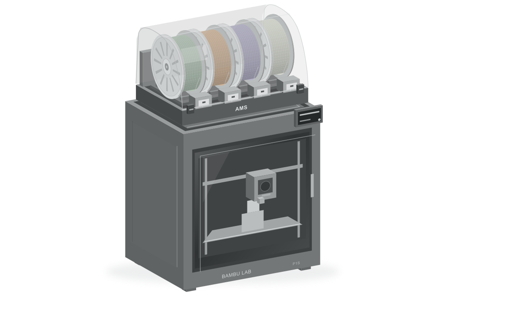
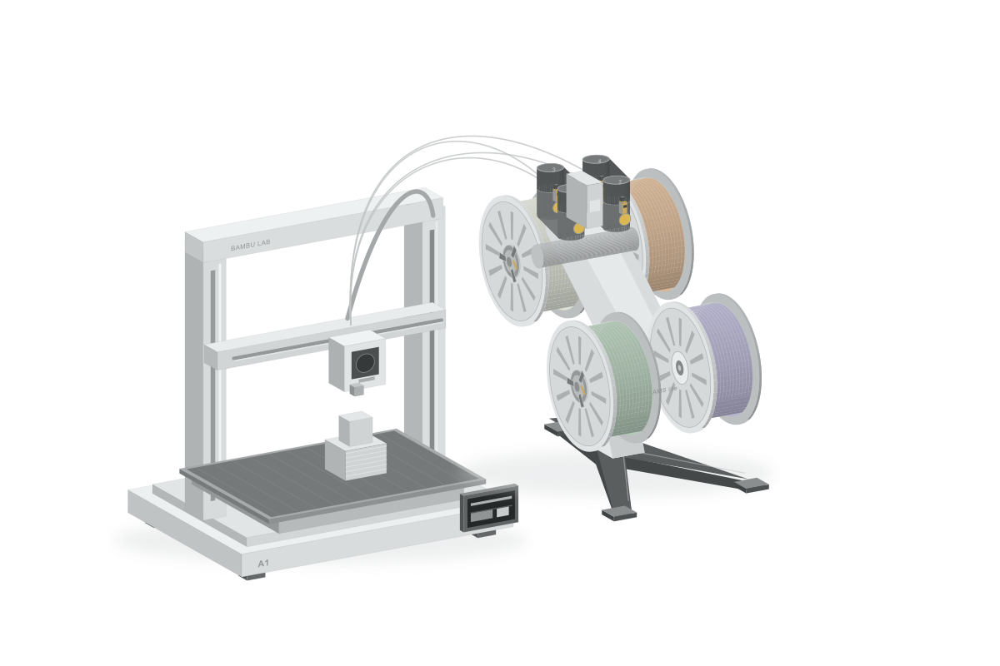
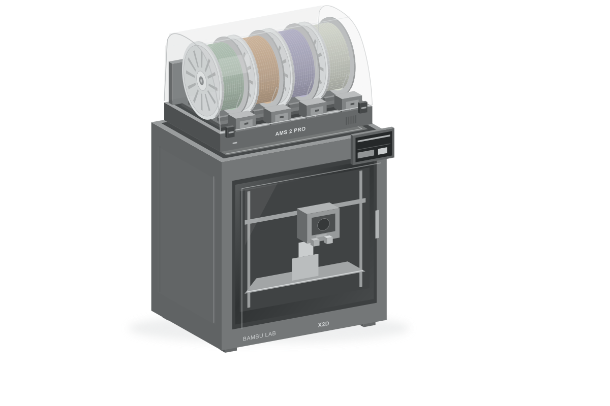
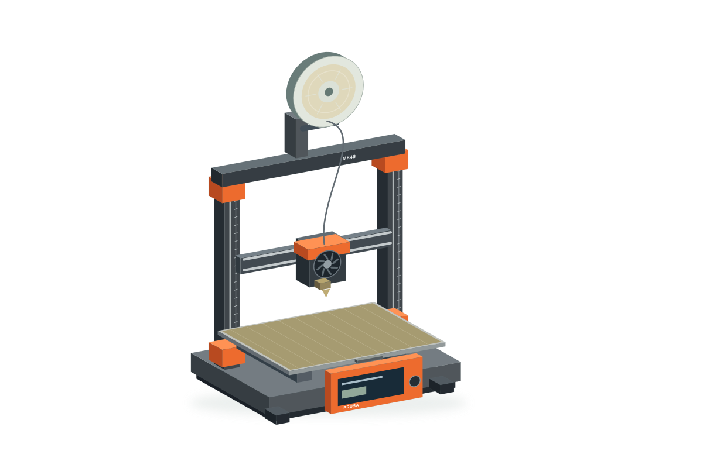

<div align="center">

# LayerHub

### A shared workspace for your 3D printers.

Prepare models. Coordinate the queue. Know what is printing.

[](https://github.com/Tuang-Gaashuan/LayerHub/actions/workflows/ci.yaml)
[](https://github.com/Tuang-Gaashuan/LayerHub/releases/tag/v0.3.0-alpha)
[](LICENSE)

**English** · [简体中文](README.zh-CN.md)

[Download](https://github.com/Tuang-Gaashuan/LayerHub/releases/tag/v0.3.0-alpha) · [Deployment](DEPLOYMENT.md) · [Validation](validation/README.md) · [Feedback](https://github.com/Tuang-Gaashuan/LayerHub/issues)

</div>

LayerHub is a **self-hosted web application for teams sharing 3D printers**. It brings model preparation, slicing, per-printer queues, spool inventory, printer status and notifications into one workspace. Members keep their own projects, share selected snapshots, and see which machine and material a job needs.

The application and data live on your NAS or a small LAN computer. An optional cloud gateway gives your team HTTPS access through a restricted outbound tunnel. Your NAS connects to the printers locally; members use a browser.

**Current release: 0.3.0-alpha, for independent deployment testing.** English and Simplified Chinese are available in the application. Hardware validation currently focuses on one X2D configuration; read [compatibility and scope](#compatibility-and-scope) before connecting a printer.

[Features](#what-you-can-do) · [Print workflow](#from-model-to-print) · [Architecture](#cloud--nas--printer) · [Quick start](#try-it-locally) · [Documentation](#documentation)

## A look inside


*The actual English interface in an isolated offline workspace. The model workbench combines a large 3D canvas, collapsible settings, plate navigation and project tools. This screenshot shows an empty workspace, without a connected printer or slicing engine.*

## What you can do

| Area | Capabilities |
|---|---|
| **Team dashboard** | See printer availability, active jobs and work waiting for attention. Open a machine's controls or its own queue. |
| **Per-printer queues** | Assign a job to a specific printer, inspect that machine's waiting tasks, and review material and device readiness before starting. The next job does not start automatically. |
| **Spool inventory** | Track individual rolls with material, color, remaining weight, shared/private ownership and printer/AMS slot mounting. Reserve material for jobs, then settle actual usage separately. |
| **Model workbench** | Import STL or supported project 3MF geometry, place and rotate objects, select several at once, duplicate, arrange copies and work across multiple plates. |
| **Slicing and preview** | Use an independently installed engine, adjust supported process settings, inspect toolpaths, review time/material estimates and compare slice results. |
| **Private and shared projects** | Save personal projects and drafts, reuse process presets, and explicitly publish versioned project snapshots to the team. Members copy snapshots into their own editable projects. |
| **Printer console** | Inspect fresh telemetry, progress and supply information; use supported pause/resume/stop, temperature, fan and light controls, camera preview and snapshots. Availability depends on model, firmware and permissions. |
| **Email notifications** | Members optionally bind and verify an email address. Job milestones go to the job owner; device completion can notify them before collection or material settlement. |
| **Deployment diagnostics** | Run local `--doctor` checks without starting the service, or inspect browser/gateway/NAS/printer segments in the administrator page. Export redacted results with actionable guidance. |
| **Accounts and preferences** | Workspace owner, administrator and member roles; personal session management, role history, owner-only backups, two interface languages and configurable reading preferences. |

### A workbench for repeated prints

Preparing several copies should not mean uploading and positioning the same file over and over. The workbench supports:

- Multi-selection, duplication, batch copy quantities, automatic arrangement and previewed distribution across plates.
- Move/rotate tools, 90° rotations and face-to-bed placement. Model resizing has a separate preview-and-apply flow to reduce accidental size changes.
- Undo/redo that preserves the current camera view, collapsible sidebars, and project/draft persistence.
- Layer height, infill, wall count, top/bottom thickness, normal/tree supports and selected object-specific process settings within the supported engine profiles.
- Private process presets, slice-result comparison and toolpath preview before a job reaches the printer queue.

Project 3MF import is a **geometry import**, with analysis and explicit confirmation. It does not promise to reproduce every setting from the originating slicer or execute embedded instructions. LayerHub is a focused browser workflow, not a complete replacement for every Bambu Studio editing tool.

### Materials and completion stay understandable

A spool is a physical roll, rather than just a material type. It can belong to the team or one member, carry a visible color, and be recorded on a printer or supply slot. Creating a job reserves its planned consumption; it does not immediately subtract the estimate from inventory.

**Device finished → collection → material settlement** are separate events. A confirmed device completion can trigger the owner's email immediately. A person still confirms collection and the actual material usage, so an uncollected part or an unmeasured roll is not silently treated as settled.

## From model to print



After reviewing a slice, choose **Confirm and print** to continue through transfer and start without several extra confirmation dialogs. **Queue only** remains available when you want to schedule work for later. Device readiness, material mapping, permissions and the print-start setting are still checked.

An uncertain start or control result requires reconciliation with the machine. Reconnection does not silently repeat a print-start command.

## Cloud → NAS → printer



| Location | Responsibility |
|---|---|
| **Cloud server** | Nginx, HTTPS certificate and a restricted SSH relay. It can also run the optional SMTP worker. |
| **NAS / LAN computer** | The single application instance, SQLite database, model files, inventory, queue and printer connections. Install the optional slicer and video components here. |
| **Printer** | LAN access and firmware-specific permissions. The NAS must be able to reach it on the local network. |
| **Member's computer** | A browser. No LayerHub desktop client is required. |

The cloud is a gateway, not a second copy of the live workspace. Do not run two application instances against the same data directory. Closing the browser does not stop NAS background work; suspending the NAS does.

For a local-only trial, use the application without a cloud gateway. A full deployment is described step by step in [Deployment](DEPLOYMENT.md).

## Try it locally

Download the **Windows amd64 ZIP** or **Linux amd64 TAR.GZ**, together with `SHA256SUMS`, from [Releases](https://github.com/Tuang-Gaashuan/LayerHub/releases/tag/v0.3.0-alpha). Verify the checksum and extract the archive. Use a fresh directory for your first trial.

### Windows

Run `start.cmd` in the extracted folder, or use PowerShell:

```powershell
Expand-Archive .\LayerHub-0.3.0-alpha-windows-amd64.zip -DestinationPath .
Set-Location .\LayerHub-0.3.0-alpha
.\start.cmd
```

### Linux

```sh
tar -xzf LayerHub-0.3.0-alpha-linux-amd64.tar.gz
cd LayerHub-0.3.0-alpha
sh start.sh
```

Open **http://127.0.0.1:5181/**. First-run credentials are generated in `data/bootstrap-admin.txt`; this initial account is the workspace owner. Change the password after signing in. Existing passwords and projects survive restarts.

The portable launcher starts in **offline mode with print start disabled**. You can explore the interface and model workbench without printer credentials. Real slicing requires an engine installed separately. Keep the launcher terminal open; **Ctrl+C** stops the application. The portable launcher does not install an autostart service.

Choose English or 简体中文 on the sign-in form, from the header language button, or in **Personal account → Language**. Account language controls future notification emails. Workbench language changes wait for an acknowledged draft save; see [Language settings](LANGUAGES.md).

## Compatibility and scope

| Capability | Current scope |
|---|---|
| **Server packages** | Windows amd64 and Linux amd64. Native Linux is the full reference deployment. Debian 13 / Ubuntu 24.04 are the deployment guide's reference systems. |
| **Printer integration** | Bambu LAN integration is implemented. Real-print validation is concentrated on **X2D / 0.4 mm / single-color PETG Basic**, with its tested firmware and supply modules. Other combinations require independent validation. |
| **Slicing** | The reference setup uses independently installed **Bambu Studio v02.08.02.61** and prepared profiles. The engine and networking plugin are not bundled. This is not a generic promise of compatibility with every slicer's CLI. |
| **Camera and controls** | Depend on the device, firmware, LAN permissions and optional NAS video components. LAN Only/Developer Mode requirements must be checked for the specific operation. |
| **Docker** | A base application template is included and statically checked. Image build/start were not executed in release validation; Studio's graphical runtime is not included. |
| **Other printer brands** | Selected models have schematic artwork for interface preparation. That artwork does **not** establish a working device adapter or control compatibility. |

Multi-nozzle/multicolor print-start, unrestricted motion/filament controls, mesh cutting and a desktop installer are outside this alpha's validated claims. Other materials, firmware and network environments need separate acceptance tests.

### Printer illustrations

LayerHub includes project-created schematic artwork for printer and supply-module configurations. These are interface illustrations, not official photographs or CAD models.

| P1S + AMS | A1 + AMS lite | X2D + AMS 2 Pro | Prusa MK4S |
|:---:|:---:|:---:|:---:|
|  |  |  |  |

*Illustrated configurations are representative. See the validation scope above for what has actually been tested.*

## Accounts, privacy and notifications

- **Workspace owner:** exactly one enabled owner; grants administrator roles, transfers ownership and handles full backup/restore.
- **Administrator:** manages ordinary members and operational tasks, without managing peer administrators or the owner.
- **Member:** uses the shared workspace with account-scoped private models, projects and drafts. Team sharing is an explicit publication step.

Members can review and revoke their other login sessions. Shared project snapshots are copied into independent private projects; editing a copy does not modify its source. Optional email binding requires verification, and members without a verified enabled address receive no mail.

Each new installation generates its own owner password and data encryption key. The repository and packages contain no production workspace or credentials. See [Security](SECURITY.md) and [Operations](OPERATIONS.md) for deployment and backup responsibilities.

## Documentation

| Topic | English | 简体中文 |
|---|---|---|
| Cloud, NAS and printer deployment | [Deployment](DEPLOYMENT.md) | [部署指导](01-部署指导-云服务器-NAS-打印机.md) |
| Independent acceptance and feedback | [Testing](TESTING.md) | [外部验收与反馈](02-外部验收与反馈.md) |
| Upgrade, backup and troubleshooting | [Operations](OPERATIONS.md) | [升级备份与排障](03-升级备份与排障.md) |
| Interface languages and email behavior | [Languages](LANGUAGES.md) | [语言设置](LANGUAGES.md#简体中文) |
| Source development | [Source README](source/README.md) | [源码说明](source/README.zh-CN.md) |

Also see [deployment diagnostics](DIAGNOSTICS.md), [slicer preparation](deploy/slicer/README.md), [optional email setup](deploy/mail/README.md), [release notes](CHANGELOG.md) and the [executed validation record](validation/README.md).

## Build from source

Requires **Go 1.27+ and Python 3**. Go dependencies are vendored; the browser runtime uses native JavaScript and bundled Three.js. Node.js 24 and the pinned npm dependencies are development/test tools, not application runtime requirements.

```sh
git clone https://github.com/Tuang-Gaashuan/LayerHub.git
cd LayerHub
sh tools/build.sh
python3 tools/package.py
```

On Windows, replace the last two commands with:

```powershell
powershell -NoProfile -ExecutionPolicy Bypass -File tools/build.ps1
python tools/package.py
```

The execution-policy flag applies only to that PowerShell process. Build outputs go into `binaries/`; portable packages go into `packages/`. They are generated artifacts, not files committed to the repository. Translation maintenance and test commands are in [source/I18N.md](source/I18N.md) and the [source README](source/README.md).

### Repository map

| Path | Contents |
|---|---|
| `source/` | Go HTTP application, SQLite persistence, JavaScript UI, vendored Go dependencies and tests |
| `source/web/` | Browser interface, local language catalogs, Three.js and printer artwork |
| `source/assets-source/` | Sources for the schematic printer illustrations |
| `deploy/cloud/` | HTTPS gateway, certificate bootstrap and restricted SSH templates |
| `deploy/nas/` | Fresh systemd installer, environment and outbound tunnel templates |
| `deploy/slicer/`, `deploy/mail/`, `deploy/docker/` | Optional component setup and base container template |
| `tools/` | Build, packaging and disposable smoke checks |
| `validation/`, `licenses/` | Redacted validation records and retained third-party licenses |

## Validation and feedback

The 0.3.0-alpha checks include **183 frontend/geometry/language tests**, Go tests and `vet`, Windows/Linux amd64 builds, disposable fresh-workspace and restart checks, and English browser verification. Language-update controls and email generation used fake devices/local queues; these are separate from the earlier attended X2D real-print validation. Docker remains static-only, and a fresh two-host installation still needs independent acceptance.

To help test, follow [Testing](TESTING.md) and open an [issue](https://github.com/Tuang-Gaashuan/LayerHub/issues) with your version, environment, reproduction steps and expected/actual behavior. Mark hardware-dependent steps as untested when you have no printer. Share redacted excerpts rather than a database, backup, access code or personal model archive.

## License

Original project code and artwork are **AGPL-3.0-only**. Third-party components retain their own licenses; see [LICENSE](LICENSE) and [Third-party notices](THIRD_PARTY_NOTICES.md).

The deployed application provides a source/license page and corresponding-source archive, including vendored Go sources. Regenerate that archive when modifying a hosted release. LayerHub is an independent project; product names and trademarks belong to their owners, and no manufacturer endorsement is claimed.
