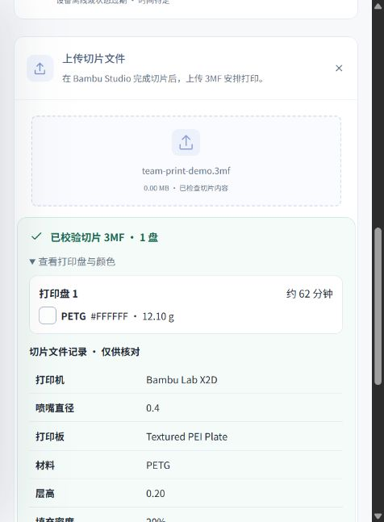
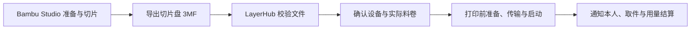

# LayerHub · 共印空间

### 从切片文件到打印完成，专注团队协作。

[English](README.md) · **简体中文**

[](https://github.com/Tuang-Gaashuan/LayerHub/releases/tag/v0.1.1-beta)
[](https://github.com/Tuang-Gaashuan/LayerHub/releases/tag/v0.4.0-alpha)

[下载 Beta](https://github.com/Tuang-Gaashuan/LayerHub/releases/tag/v0.1.1-beta) · [下载 Alpha](https://github.com/Tuang-Gaashuan/LayerHub/releases/tag/v0.4.0-alpha) · [版本区别](CHANNELS.md#简体中文) · [部署指南](01-部署指导-云服务器-NAS-打印机.md) · [文件要求](IMPORTING.md) · [验证记录](validation/README.md)

LayerHub 是面向多人共用 3D 打印机的自部署网页应用。成员使用 **Bambu Studio 完成模型准备与切片**，再通过 LayerHub 分配设备、确认实际料卷、协调单机队列、查看进度并接收通知。

**推荐组合：LayerHub Beta + [Bambu Studio](https://github.com/bambulab/BambuStudio)。** 在电脑上完成模型准备与切片，再将已切片 3MF 上传到 LayerHub，进行团队排队、设备控制和通知。

## main 最新更新（尚未打新标签）

`main` 已包含以下内容。**现有 v0.1.1-beta 发布下载包保持不变**；需要这些新增功能时，请从当前分支构建。

- 合并上传到打印前的准备步骤，逐盘排队、调整顺序、指定下一项，以及取消尚未启动的任务；不自动连续开打。
- X2D 原生归位与 XYZ 小步移动，保留现场清板、状态新鲜度和结果核对要求，见[移动范围与实机证据](MOTION.md)。
- A1 小数温度、低帧率相机说明，以及现场验证过亮灭的照明灯。灯光回执仅表示接受，界面显示上次请求。A1 移动与完整打印、取件和耗材结算闭环仍未验收通过。
- 完成后缺失原任务的设备保持待登记状态；必须明确确认取件及实际用量，不自动放行或扣减库存，见[稳定性说明](STABILITY.md)。
- 修复字体应用和长页面、侧栏滚动，重新整理源码与许可证页面。
- 左侧导航第一项新增 **Bambu Studio**，本机路径只存浏览器，首次由用户导入 Windows 配置，见[设置与移除方法](STUDIO_SHORTCUT.md)。

## v0.1.1-beta 更新

本版统一加入多盘选盘与批量入队、机身终止收尾、控制响应优化、A1 外置料架准备和一键下载/更新工具。见[发布说明](RELEASE_NOTES.md)、[工具包操作](deploy/update-kit/README.zh-CN.md)、[A1 接入](A1_SETUP.md)和[多盘导入](MULTIPLATE.md)。

**升级前备份：** 数据库升级至 schema 5，NAS 后端和云端网页需在空闲时统一更新；回退旧程序须恢复匹配的升级前工作空间。A1 实机和真实多盘文件仍需现场验收。

## Beta 与 Alpha 两条路线

| 版本 | 定位 | 后续维护 | 版本标签 | 下载 |
|---|---|---|---|---|
| **Beta · 推荐使用** | 团队打印管理，只上传已切片 3MF | [`main`](https://github.com/Tuang-Gaashuan/LayerHub/tree/main) 为主要功能完善方向 | [`v0.1.1-beta`](https://github.com/Tuang-Gaashuan/LayerHub/tree/v0.1.1-beta) | [Beta 发布页](https://github.com/Tuang-Gaashuan/LayerHub/releases/tag/v0.1.1-beta) |
| **Alpha · 实验性工作台** | 团队打印管理，含内置模型工作台与在线切片 | [`alpha`](https://github.com/Tuang-Gaashuan/LayerHub/tree/alpha) 保留工作台，缓慢推进 | [`v0.4.0-alpha`](https://github.com/Tuang-Gaashuan/LayerHub/tree/v0.4.0-alpha) | [Alpha 发布页](https://github.com/Tuang-Gaashuan/LayerHub/releases/tag/v0.4.0-alpha) |

Beta 持续优先完善团队协作、队列、耗材、控制与通知，已移除模型工作台及相应编辑、几何导入、在线切片和共享模型工程代码。Alpha 保留这些实验功能，在独立分支继续逐步改进。两个版本目前都属于预发布，分别维护版本号。详见[版本区别与维护政策](CHANNELS.md#简体中文)；已有工作区的数据保留及切换步骤见 [Beta 迁移说明](BETA_MIGRATION.md)。

## Beta 保留的能力

| 模块 | 功能 |
|---|---|
| 协作看板 | 查看设备可用性、当前打印、单机排队与待处理事项 |
| 切片 3MF 上传 | 校验实际文件内容，预览各盘颜色、材质、用时与用量，保留原切片工艺 |
| 逐机任务队列 | 用户确认设备和料卷，预留耗材，再进行准备、传输与启动；也可仅排队 |
| 逐卷耗材库 | 公共/个人耗材、颜色、余量，以及打印机和 AMS 槽位装载登记 |
| 设备控制台 | 新鲜遥测、供料状态、受支持的基础控制、摄像头视频与拍照 |
| 邮件通知 | 成员自愿绑定并验证邮箱，开始、设备完工等里程碑通知任务所有者 |
| 团队与安全 | 所有者、管理员、成员三级角色，会话管理、操作记录、所有者备份恢复 |
| 阅读偏好 | 简体中文 / English、字体及文字外观设置 |
| 部署与连接诊断 | 启动前 `--doctor`，分段查看浏览器、云网关、NAS 与打印机，导出脱敏报告 |

## 使用流程



离线演示工作区：直接查看打印盘、颜色和预计值。[英文看板截图](validation/beta-dashboard-en.png)。



上传**只接受已经切片的 `.3mf`**，包括 `.gcode.3mf`。按内容识别，重命名 STL、原始 G-code 或未切片工程不能通过校验。检查不会创建任务、预留库存或发送设备指令。单盘自动预填预计值；多盘与缺失项留空，由用户确认。[文件导入说明](IMPORTING.md)。

检查文件不会启动打印。设备、队首、机型、喷嘴、打印板、材质、供料映射和授权校验继续保留，未知结果的启动指令不会因重连自动重发。设备完工即可通知任务所有者，人工取件与实际用量结算分别登记。

## 云服务器 → NAS → 打印机

NAS 运行唯一的业务应用和 SQLite 数据库，在局域网中连接打印机；主动建立受限 SSH 隧道到云端。云服务器提供 HTTPS 和中继，可选运行邮件工作器。成员用浏览器访问，Bambu Studio 在成员电脑运行。**NAS 无需安装切片引擎。** 挂起 NAS 仍会打断服务，开机自启不能防止挂起掉线。

## 本地试用

从 [v0.1.1-beta](https://github.com/Tuang-Gaashuan/LayerHub/releases/tag/v0.1.1-beta) 下载平台包和 `SHA256SUMS`，校验后解压到新文件夹。

Windows PowerShell：

```powershell
Get-FileHash .\LayerHub-0.1.1-beta-windows-amd64.zip -Algorithm SHA256
Expand-Archive .\LayerHub-0.1.1-beta-windows-amd64.zip -DestinationPath .
Set-Location .\LayerHub-0.1.1-beta
.\start.cmd
```

Linux：

```sh
grep 'LayerHub-0.1.1-beta-linux-amd64.tar.gz$' SHA256SUMS | sha256sum -c -
tar -xzf LayerHub-0.1.1-beta-linux-amd64.tar.gz
cd LayerHub-0.1.1-beta
sh start.sh
```

打开 `http://127.0.0.1:5181/`。全新安装默认 offline、关闭打印启动，随机所有者账号保存在 `data/bootstrap-admin.txt`，请自行读取并保密。关闭启动窗口会停止本地试用服务。已有部署按[迁移说明](BETA_MIGRATION.md)升级，不运行首次安装器覆盖原目录。

## 当前范围

提供 Windows amd64 / Linux amd64 包，原生 Linux 为 NAS 参考部署。Docker 仍只提供模板与静态检查，容器实跑需要独立验收。视频和 SMTP 实际投递取决于组件、固件权限与配置。

历史实机打印验证集中于 **X2D / 0.4 mm / 单色 PETG Basic / 首个 AMS**。机型插画不等于控制兼容承诺，Beta 没有新增多色或双喷嘴启动支持。

| 文档 | 内容 |
|---|---|
| [云服务器—NAS—打印机部署](01-部署指导-云服务器-NAS-打印机.md) | 分工、网络与安装步骤 |
| [文件导入](IMPORTING.md) | 切片 3MF 要求与任务准备 |
| [Beta 迁移](BETA_MIGRATION.md) | 移除项、历史数据及回退 |
| [升级与排障](03-升级备份与排障.md) | 维护、备份与恢复 |
| [部署诊断](DIAGNOSTICS.md) | 本地检查和连接证据 |
| [外部验收](02-外部验收与反馈.md) | 独立部署与现场验证 |
| [语言设置](LANGUAGES.md) | 账户语言和邮件行为 |

## 源码与许可证

使用 Go 1.27、Node.js 24、Python 3 构建与测试，Go 依赖源码已纳入 vendor。运行 `sh tools/build.sh` 或 `tools/build.ps1`，详见 [源码说明](source/README.md)。运行应用不依赖 Node、Python、Three.js 或切片引擎。

项目原创代码与结构插画采用 **AGPL-3.0-only**，第三方依赖保留各自许可证，见[声明](THIRD_PARTY_NOTICES.md)。部署页面底部提供对应源码下载。公开仓库和发布包不包含账号、数据库、凭据、私人上传或备份，反馈时请提供脱敏复现信息。


[A1 无 AMS 接入准备](A1_SETUP.md) · [多盘导入说明](MULTIPLATE.md)
