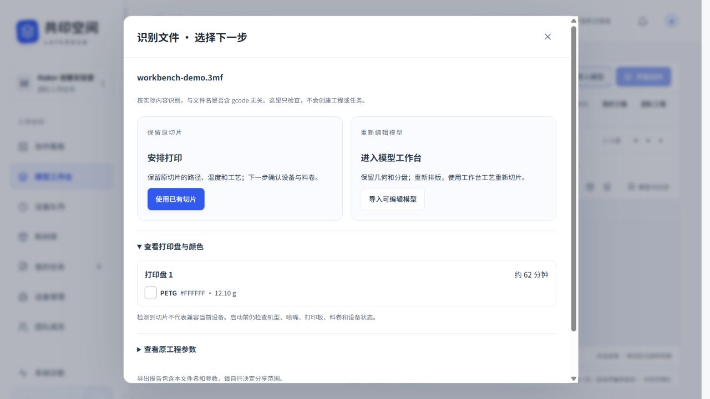
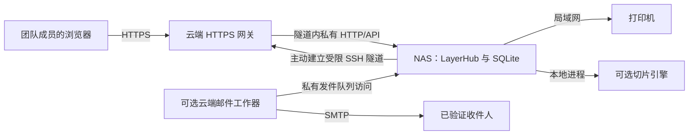

<div align="center">

# LayerHub · 共印空间

### 为多人共用 3D 打印机打造的协作工作空间

准备模型，安排队列，了解每一台机器正在做什么。

[](https://github.com/Tuang-Gaashuan/LayerHub/actions/workflows/ci.yaml)
[](https://github.com/Tuang-Gaashuan/LayerHub/releases/tag/v0.4.0-alpha)
[](LICENSE)

[English](README.md) · **简体中文**

[下载软件](https://github.com/Tuang-Gaashuan/LayerHub/releases/tag/v0.4.0-alpha) · [部署指导](01-部署指导-云服务器-NAS-打印机.md) · [验证记录](validation/README.md) · [反馈问题](https://github.com/Tuang-Gaashuan/LayerHub/issues)

</div>

LayerHub 是一个可自行部署的 **3D 打印协作网页应用**。它把模型准备、在线切片、逐台打印机排队、逐卷耗材管理、设备状态和邮件通知放在同一个空间里。成员保留自己的工程，也能把选定的版本分享给团队，共同了解任务需要哪台机器、哪卷耗材。

软件和数据运行在 NAS 或局域网小主机上，由它连接打印机；可选的云服务器通过受限主动隧道提供 HTTPS 入口。成员使用浏览器即可访问。

**当前版本为 0.4.0-alpha，面向独立部署测试。** 软件已支持简体中文与 English。实机验证目前集中于一套 X2D 配置，接入设备前请先阅读[兼容性与当前边界](#兼容性与当前边界)。

[功能介绍](#它能做什么) · [打印流程](#从模型到打印) · [部署架构](#云服务器--nas--打印机) · [快速试用](#先在本地试用) · [文档导航](#文档导航)

## 界面一览


*软件的真实英文界面，拍摄于独立离线工作区。模型工作台提供大面积三维视图、可收起的参数栏、多盘切换与工程工具。图中尚未导入模型，也未连接打印机或切片引擎；中文界面可在软件内直接切换。*

## 它能做什么

| 模块 | 已有能力 |
|---|---|
| **协作看板** | 集中查看设备是否可用、当前任务与待处理事项，进入对应机器的控制台或队列。 |
| **逐机任务队列** | 为任务选择具体打印机，了解每台机器各自的等待情况，启动前检查设备与耗材。下一项任务不会自动开打。 |
| **逐卷耗材库** | 记录材质、颜色、余量、公共/个人归属和打印机/AMS 装载槽位；任务预留与实际用量结算分别处理。 |
| **模型工作台** | 导入 STL 或受支持的工程 3MF 几何，摆放、旋转、多选、复制、自动排版，并在多个打印盘之间组织对象。 |
| **文件检查** | 两个入口按内容识别 3MF，分别提供编辑与保留切片的路径，显示各盘颜色、预计值、原参数对照，并支持导出检查报告。 |
| **在线切片与预览** | 调用独立安装的引擎，调整受支持的工艺参数，查看路径与时长/用量估算，对比切片结果。 |
| **私有工程与团队分享** | 保存个人工程、草稿和工艺预设，明确发布带版本的团队快照；成员复制成自己的工程后独立编辑。 |
| **设备控制台** | 查看新鲜遥测、进度和供料信息，使用受支持的暂停/继续/停止、温度、风扇、灯光控制，以及摄像头预览和拍照。具体能力取决于机型、固件和权限。 |
| **邮件通知** | 成员自愿绑定并验证邮箱；任务里程碑通知对应任务所有者。设备完工即可通知，无需等人工取件或结算。 |
| **部署与连接诊断** | 服务启动前使用 `--doctor` 本地自检，管理员页面分段查看浏览器、网关、NAS 与打印机，并导出脱敏报告和修复建议。 |
| **账户与个性化** | 所有者/管理员/成员三级权限，个人会话管理、权限记录、所有者备份恢复，以及双语、字体和阅读偏好。 |

### 同一个东西，多打几份

批量准备不必反复上传同一个文件。模型工作台已经支持：

- 多选、复制、填写新增份数、自动排版，以及先预览再应用的自动分盘。
- 移动、旋转、90° 快捷翻面和选面贴底；模型尺寸调整有独立的预览与应用流程，减少误改尺寸。
- 撤销/重做保留观察视角，左右栏可收起，工程与草稿可保存、恢复。
- 在受支持配置内调整层高、填充、墙数、顶底厚度、普通/树状支撑及部分对象级工艺。
- 复用个人工艺预设，对比切片结果，在进入队列前检查路径预览。

工程 3MF 采用**几何导入**，先分析，再由用户确认。它不承诺还原原切片软件的全部设置，也不会执行文件内嵌指令。LayerHub 聚焦浏览器中的准备与协作流程，尚未覆盖 Bambu Studio 的全部编辑工具。

### 每卷耗材、每次完工都能说清楚

耗材库中的一条记录代表一卷实物。它可以属于团队或个人，有明确颜色、剩余重量，并记录装在哪台打印机、哪个供料槽位上。创建任务时先预留计划用量，不会立即按照估算值扣库。

**设备打印完成 → 人工取件 → 实际用量结算**分别记录。设备确认完工后即可给任务所有者发邮件；是否取件、实际使用多少耗材，仍由人确认，避免把未取走的成品或尚未测量的用量直接算作已结清。

### 把 Studio 文件交给正确的流程

从任一入口选择 3MF，保存前先按内容检查。可保留原切片的路径与工艺，也可明确选择导入几何后重新编辑、切片。原机型、材料和工艺参数与工作台默认值并列供核对，切片则按盘显示颜色、时间与用量。单盘预填预计值，缺失项和多盘预计值留空；后端拒绝把未切片的 3MF 加入打印队列。[导入说明与限制](IMPORTING.md)。



*隔离工作区中使用演示文件的实际检查界面，没有发送设备指令。*

## 从模型到打印


检查切片后，选择**确认并打印**，后台连续完成传输与启动，减少重复确认；希望稍后安排时，也能选择**仅加入队列**。设备是否就绪、耗材映射、操作权限与打印启动开关仍会检查。

如果启动或控制结果未确认，需要先核对机器。网络恢复不会静默重发启动指令。

## 云服务器 → NAS → 打印机



| 位置 | 负责什么 |
|---|---|
| **云服务器** | Nginx、HTTPS 证书和受限 SSH 中继；可选部署 SMTP 邮件工作器。 |
| **NAS / 局域网小主机** | 唯一的业务应用、SQLite 数据库、模型文件、耗材、队列与打印机连接；可选切片引擎和视频组件也安装在这里。 |
| **打印机** | 提供局域网访问及对应固件权限；NAS 必须能在本地网络中访问它。 |
| **成员电脑** | 使用浏览器，不需要安装 LayerHub 桌面客户端。 |

云端是访问网关，不是第二份实时工作区。同一份数据目录不能同时由两个应用实例使用。关闭浏览器不会停止 NAS 的后台工作，但让 NAS 挂起会中断连接。

只在本地试用时不需要云服务器。完整部署顺序与命令见[部署指导](01-部署指导-云服务器-NAS-打印机.md)。

## 先在本地试用

从 [Releases](https://github.com/Tuang-Gaashuan/LayerHub/releases/tag/v0.4.0-alpha) 下载 **Windows amd64 ZIP** 或 **Linux amd64 TAR.GZ**，同时下载 `SHA256SUMS` 并核对校验值。第一次试用请解压到新的文件夹。

### Windows

在解压后的目录运行 `start.cmd`，也可以使用 PowerShell：

```powershell
Expand-Archive .\LayerHub-0.4.0-alpha-windows-amd64.zip -DestinationPath .
Set-Location .\LayerHub-0.4.0-alpha
.\start.cmd
```

### Linux

```sh
tar -xzf LayerHub-0.4.0-alpha-linux-amd64.tar.gz
cd LayerHub-0.4.0-alpha
sh start.sh
```

打开 **http://127.0.0.1:5181/**。首次启动会在 `data/bootstrap-admin.txt` 生成独立账号和密码，该账号就是空间所有者。登录后请修改密码；以后重启不会重置已有密码和工程。

便携启动器默认采用**离线模式，并关闭打印启动**。不提供打印机凭据也能探索界面、导入和查看模型；真实切片需要另行安装引擎。运行时保持终端窗口开启，**Ctrl+C** 停止服务。便携启动器不会自行安装开机自启服务。

登录页、顶部语言按钮和**个人账户 → 语言**均可切换简体中文或 English；账号语言用于后续通知邮件。工作台切换语言前会等待草稿保存确认，详见[语言设置](LANGUAGES.md#简体中文)。

## 兼容性与当前边界

| 项目 | 当前范围 |
|---|---|
| **服务端系统** | Windows amd64、Linux amd64。原生 Linux 为完整链路的参考部署；部署文档以 Debian 13 / Ubuntu 24.04 为参考系统。 |
| **打印机接入** | 已实现 Bambu 局域网接入；真实打印验证集中于 **X2D / 0.4 mm / 单色 PETG Basic** 的既有固件与供料模块组合。其他组合需要独立验证。 |
| **切片引擎** | 参考方案使用独立安装的 **Bambu Studio v02.08.02.61** 与准备好的配置。软件包不内置引擎或联网插件，也不保证任意切片器的命令行接口可直接替换。 |
| **摄像头与控制** | 取决于设备、固件、局域网权限和 NAS 视频组件。具体操作所需的局域网/开发者模式应逐项核对。 |
| **Docker** | 提供基础应用模板，已做静态检查；本次发布未执行镜像构建与容器启动，也未内置 Studio 图形运行环境。 |
| **其他品牌** | 部分机型已经准备结构插画，供界面展示使用；有插画不等于已完成设备驱动或控制适配。 |

多喷嘴/多色启动、无限制运动/进退料控制、网格切割和桌面安装器不在本 alpha 的已验证承诺范围内。其他材料、固件与网络环境也需要分别验收。

### 打印机插画

项目提供打印机与供料模块配置的结构示意图，用来区分不同设备的外观。它们是自行制作的界面素材，不是官方照片或 CAD。

| P1S + AMS | A1 + AMS lite | X2D + AMS 2 Pro | Prusa MK4S |
|:---:|:---:|:---:|:---:|
|  |  |  |  |

*图中配置为代表性展示。实际已经验证的接入范围以上表为准。*

## 团队权限、隐私与通知

- **空间所有者**：始终只有一位有效所有者，可授予管理员、转让所有权和进行完整备份恢复。
- **管理员**：管理普通成员与日常业务，不能管理同级管理员或所有者。
- **成员**：使用协作空间；模型、工程和草稿按账号隔离，分享给团队需要明确发布。

成员可以查看并退出自己其他设备上的登录。团队快照复制后成为独立私有工程，修改副本不影响原作者的版本。邮箱绑定为可选功能，需要验证码验证；未绑定已验证且启用的地址就不发邮件。

每次全新安装都会生成自己的所有者密码和数据加密密钥。仓库及发布包不包含开发者的生产工作区或凭据。部署与备份责任见[安全说明](SECURITY.md)和[运维指导](03-升级备份与排障.md)。

## 文档导航

| 内容 | 简体中文 | English |
|---|---|---|
| 云服务器、NAS 与打印机部署 | [部署指导](01-部署指导-云服务器-NAS-打印机.md) | [Deployment](DEPLOYMENT.md) |
| 独立验收与问题反馈 | [外部验收与反馈](02-外部验收与反馈.md) | [Testing](TESTING.md) |
| 升级、备份与故障排查 | [升级备份与排障](03-升级备份与排障.md) | [Operations](OPERATIONS.md) |
| 界面语言与邮件规则 | [语言设置](LANGUAGES.md#简体中文) | [Languages](LANGUAGES.md) |
| 源码开发 | [源码说明](source/README.zh-CN.md) | [Source README](source/README.md) |

还可以查看[部署与连接诊断](DIAGNOSTICS.md)、[切片引擎准备](deploy/slicer/README.md)、[可选邮件配置](deploy/mail/README.md)、[更新记录](CHANGELOG.md)和[已执行的验证记录](validation/README.md)。

## 从源码构建

需要 **Go 1.27+ 与 Python 3**。Go 依赖源码已包含在 `source/vendor/`；浏览器使用原生 JavaScript 和随包提供的 Three.js。Node.js 24 及固定版本 npm 依赖用于开发/测试，不是应用运行的必装条件。

```sh
git clone https://github.com/Tuang-Gaashuan/LayerHub.git
cd LayerHub
sh tools/build.sh
python3 tools/package.py
```

Windows 将最后两条命令替换为：

```powershell
powershell -NoProfile -ExecutionPolicy Bypass -File tools/build.ps1
python tools/package.py
```

执行策略参数仅作用于这次 PowerShell 进程。构建后程序位于 `binaries/`，便携包位于 `packages/`；这两个目录是构建产物，不会直接提交到仓库。翻译维护和测试命令见 [source/I18N.md](source/I18N.md) 与[源码说明](source/README.zh-CN.md)。

### 仓库结构

| 路径 | 内容 |
|---|---|
| `source/` | Go HTTP 应用、SQLite 持久化、JavaScript 界面、Go 依赖源码和测试 |
| `source/web/` | 网页界面、本地语言包、Three.js 和设备插画 |
| `source/assets-source/` | 打印机结构示意图的生成源文件 |
| `deploy/cloud/` | HTTPS 网关、证书初始化和受限 SSH 模板 |
| `deploy/nas/` | 全新安装 systemd 脚本、环境配置和主动隧道模板 |
| `deploy/slicer/`、`deploy/mail/`、`deploy/docker/` | 可选组件安装说明与基础容器模板 |
| `tools/` | 构建、打包和隔离冒烟检查工具 |
| `validation/`、`licenses/` | 脱敏验证记录与第三方许可证 |

## 验证现状与参与测试

0.4.0-alpha 已完成 **189 项前端/几何/语言测试**、Go 测试与 `vet`、Windows/Linux amd64 构建、全新隔离工作区启动/重启检查，以及英文浏览器验证。语言更新中的控制和邮件生成使用假设备、本地队列测试，与早先有人在场的 X2D 真机打印验收分别记录。Docker 仍只做静态检查；全新双主机安装仍需独立验收。

欢迎按[验收表](02-外部验收与反馈.md)测试，在 [Issues](https://github.com/Tuang-Gaashuan/LayerHub/issues) 提供版本、环境、复现步骤及预期/实际结果。没有打印机时，把依赖硬件的步骤标记为未测试即可。反馈时使用脱敏片段，不要上传数据库、备份、访问码或私人模型集合。

## 开源许可

项目自身代码与原创插画采用 **AGPL-3.0-only**。第三方组件保留各自许可，见 [LICENSE](LICENSE) 和[第三方声明](THIRD_PARTY_NOTICES.md)。

已部署界面提供源码/许可证入口和包含 Go 依赖源码的对应源码压缩包。修改并对外提供服务时，应同步更新该下载内容。LayerHub 为独立项目，产品名称与商标归各自所有者，不代表厂商背书。
