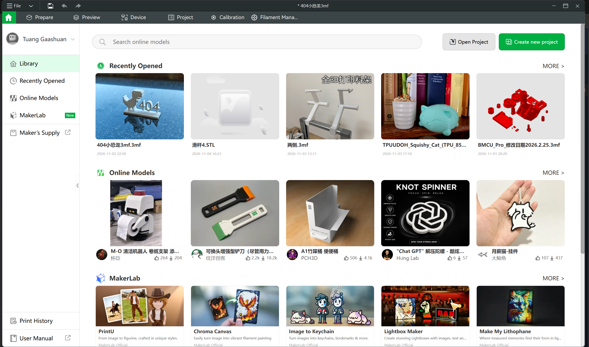
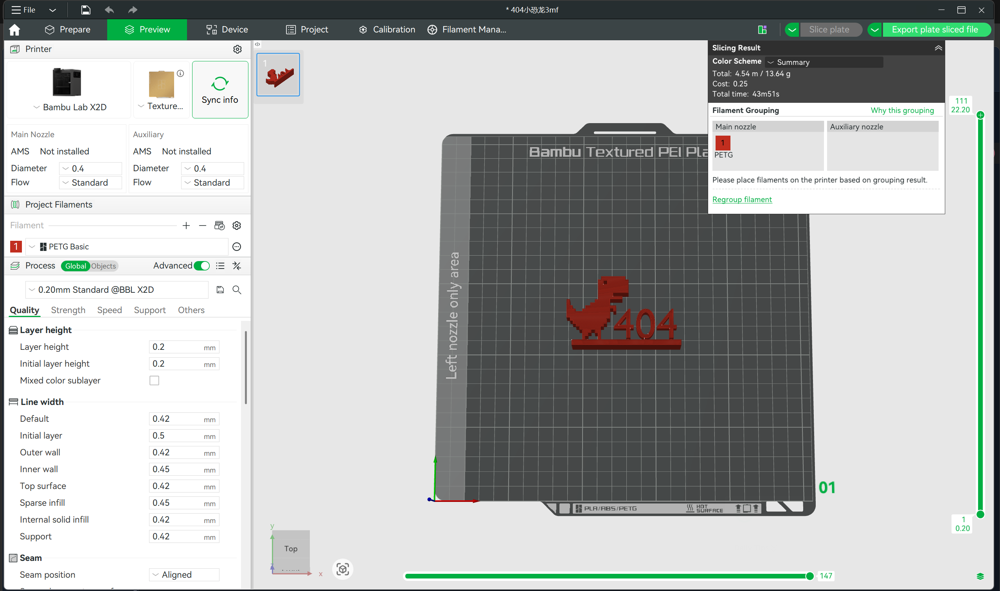
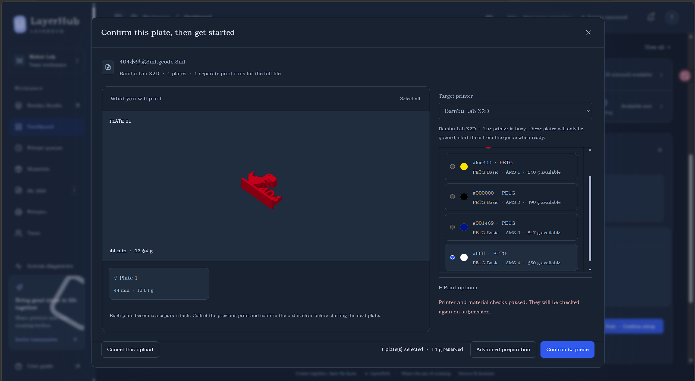

# Workflow: Bambu Studio → LayerHub → printer

[简体中文](USAGE.zh-CN.md) · [Back to the README](README.md)

**Slice in Bambu Studio and export the sliced file. Upload it to LayerHub, confirm the printer and loaded spools, then start printing or add the job to that printer’s queue.** LayerHub Beta handles team scheduling and printer management; Bambu Studio handles model preparation and slicing.

## 1. Open a model or project in Bambu Studio

Open an existing project, or create one and import a model. Select the actual printer model, nozzle diameter, build plate and filament profile, then prepare placement, supports and process settings. X2D / PETG in these screenshots is an example; use the configuration of your own printer and filament.

## 2. Slice and export a sliced 3MF

Click **Slice plate**, then check the model, supports, estimated time and material in **Preview**. Use the upper-right menu to select **Export plate sliced file**. For multiple plates, choose the option to export all sliced plates. Exact labels can vary between Studio versions.

Save the **already-sliced `.3mf` file**, commonly named `*.gcode.3mf`. An unsliced project saved with the ordinary project-save command, an STL, or raw G-code is not an accepted Beta upload. Renaming a file does not make it sliced.

## 3. Upload to LayerHub and confirm the print setup

1. Sign in to your team workspace. Choose or drop the sliced file in the dashboard upload area.
2. Wait for the upload to finish. Versions with background inspection continue parsing on the NAS. Staying on the page opens confirmation automatically; after leaving, resume from the background file list. **Closing the page before the upload finishes can still interrupt the upload.**
3. Select the plates, target printer and actual loaded spools. Each spool must be accessible, match the sliced material and have enough available weight. Check the preview, time and material estimate for every plate. Selecting a different color does not change the sliced temperatures or process.
4. Read the action at the bottom: when ready, confirm that the bed is clear and choose **Confirm and start printing**, or use **Queue only**. If the printer is busy, has waiting jobs or cannot start yet, the page explains the reason and offers **Confirm & queue**.

**The screenshot shows a queue-only case:** the printer is busy. The selected white PETG spool passes the material checks, so the job can be queued; it does not start immediately. UI details may differ slightly in newer builds.

## 4. Start now or start later from the printer queue

| Action | Result |
| --- | --- |
| Confirm and start printing | Rechecks the printer and queue, saves the job and preparation, transfers the file and requests the selected first plate to start; no second preparation round in the queue is needed |
| Queue only / Confirm & queue | Saves the jobs and material reservations without starting; view and reorder them in the printer queue, then explicitly start when ready |
| Cancel this upload | Exits the current upload preparation; if submission has already created jobs, follow the displayed submission result |

For multi-plate files, **each plate is a separate print run**. Starting a selected batch starts only the chosen first plate; other plates stay queued. Collect the previous print, clear the bed and explicitly confirm the next plate. Subsequent plates never start unattended automatically.

## 5. Collect the print and confirm actual material usage

Use the printer console to monitor actual device status. When the device reports completion, a completion email can be sent according to the owner’s notification settings, independently of pickup registration. Collect the part, clear the bed and confirm actual material usage. Inventory weight is deducted at settlement; a reservation is not recorded consumption.

## Common questions

- **No matching spool?** Check ownership/sharing, material, remaining weight and the exact mounted printer/slot in the material library. Similar names such as TPU and TPU for AMS do not make different sliced profiles interchangeable.
- **Only queueing is available?** Read the printer, queue, connection and preparation checks. Queueing does not interrupt the current print.
- **Printer data differs from inventory?** The current **Update from printer** action corrects material and color on the existing record while retaining grams. It does not detect a physical spool replacement or unmount the old roll automatically. Preserve the old roll and its remaining stock when updating mounts after a real spool change.
- **Unclear start result?** Use the submission review action and check the real printer before trying again.

More: [File requirements](IMPORTING.md) · [Multiple plates](MULTIPLATE.md) · [Upload flow](UPLOAD_FLOW.md) · [Deployment](DEPLOYMENT.md)
