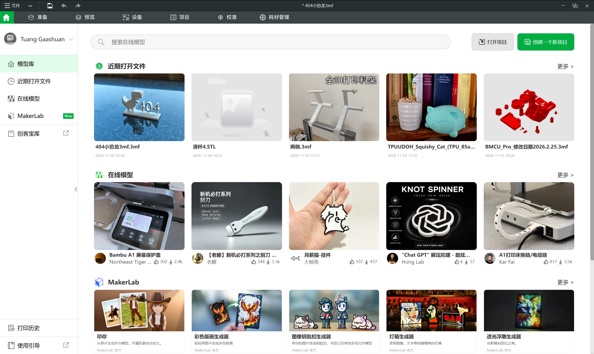
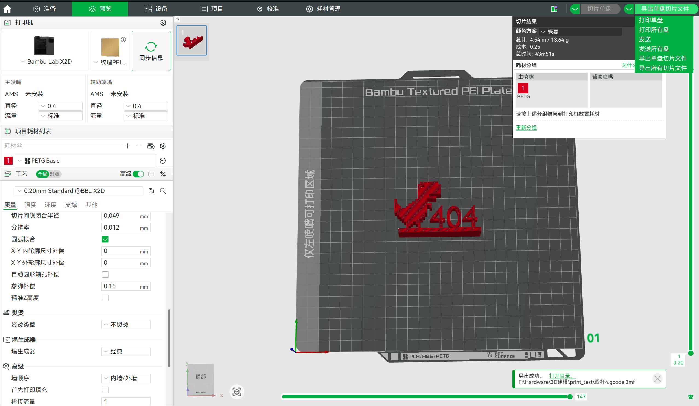
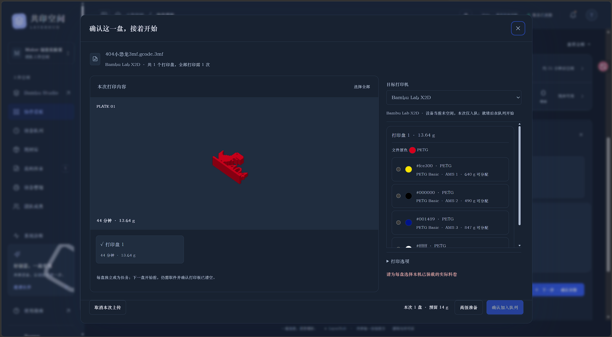

# 使用流程：Bambu Studio → LayerHub → 打印机

[English](USAGE.md) · [返回首页](README.zh-CN.md)

**在 Bambu Studio 完成切片并导出切片文件，然后在 LayerHub 上传、核对设备与实际料卷；确认后即可开始打印，或加入目标打印机的队列。** LayerHub Beta 负责团队管理、排队与打印控制，模型准备和切片由 Bambu Studio 完成。

## 1. 在 Bambu Studio 打开模型或工程

打开已有工程，或创建工程并导入模型。按实际设备选择打印机型号、喷嘴直径、打印板和耗材预设，再设置摆放、支撑及打印工艺。截图中的 X2D / PETG 只是示例，请使用自己的设备和材料配置。

## 2. 完成切片，导出已切片的 3MF

点击“切片单盘”，在“预览”中检查模型、支撑、预计时间与用料。通过右上角菜单选择“导出单盘切片文件”；需要多盘时选择“导出所有切片文件”。不同 Studio 版本的按钮文字可能略有差异。

保存得到的**已切片 `.3mf` 文件**，通常以 `.gcode.3mf` 结尾。普通“保存工程”得到的未切片 3MF、STL 和原始 G-code 不属于 Beta 的上传格式；仅改扩展名也不能替代切片。

## 3. 上传到 LayerHub，确认打印安排

1. 登录团队工作区，在协作看板的上传区域选择或拖入切片文件。
2. 等待上传完成。支持后台解析的版本会继续在 NAS 上解析文件；留在当前界面会自动进入确认页，离开后可从后台文件列表继续。**上传尚未完成时关闭页面仍可能中断上传。**
3. 选择本次需要打印的盘、目标设备，以及机器上实际装载、材质匹配且余量充足的料卷。核对每盘的预览、时间和耗材用量；选择不同颜色不会转换文件里的温度和工艺。
4. 查看底部按钮：满足启动条件时，可以确认打印板已清空后点击“确认并开始打印”；也可以选择“仅加入队列”。设备忙碌、已有等待任务或启动条件不足时，界面会说明原因，并提供“确认加入队列”。

**图中示例是排队场景：** 设备正在忙碌，而且尚未选择实际料卷，所以不能直接启动。先完成料卷选择；满足检查要求后可以确认入队。当前版本的界面细节可能与截图略有不同。

## 4. 立即开始，或在队列中稍后开始

| 选择 | 结果 |
| --- | --- |
| 确认并开始打印 | 再次检查设备与队列，保存任务和供料准备，传输文件并请求启动本次选定的首盘；无需返回队列再点击一轮准备 |
| 仅加入队列 / 确认加入队列 | 保存任务及耗材预留，暂不启动；在该打印机队列中查看、调整顺序，并在就绪后确认开始 |
| 取消本次上传 | 退出当前上传准备流程；已创建任务的处理以界面显示的提交结果为准 |

多盘文件中，**每盘对应一次独立打印**。如果选择多盘并立即开始，只启动指定的首盘，其余盘进入队列。上一盘结束后，需要取件、清空打印板并确认下一盘，系统不会无人确认地连续开打。

## 5. 打印完成后登记取件与实际用量

在设备控制台查看真实状态与进度。设备报告完工后，可按个人通知设置发送完成邮件；邮件发送不需要等待人工取件登记。取下成品、清空打印板，再确认实际耗材用量；库存克数在结算时扣减，预留量不等于已经消耗的重量。

## 常见问题

- **找不到可选耗材？** 在耗材库确认料卷属于自己或团队可用范围，并挂载到目标机器的实际料位；材质须匹配切片。TPU 与 TPU for AMS 等预设不能仅凭名字相近就互换。
- **按钮只能入队？** 先查看设备忙碌、队列、连接和准备检查的具体提示；排队不会自动中断当前打印。
- **机器信息与库存登记不同？** 当前“按打印机更新”用于校正该条记录的材质和颜色，保留克数；它不会自动识别换卷或解除原卷挂载。实际换卷时应保留原卷记录和余量，按实际情况调整挂载。
- **启动结果不明确？** 使用页面上的结果核对入口，先查看设备实际状态，不要重复点击启动。

更多说明：[文件格式](IMPORTING.md) · [多盘队列](MULTIPLATE.md) · [上传到打印](UPLOAD_FLOW.md) · [部署指南](01-部署指导-云服务器-NAS-打印机.md)
